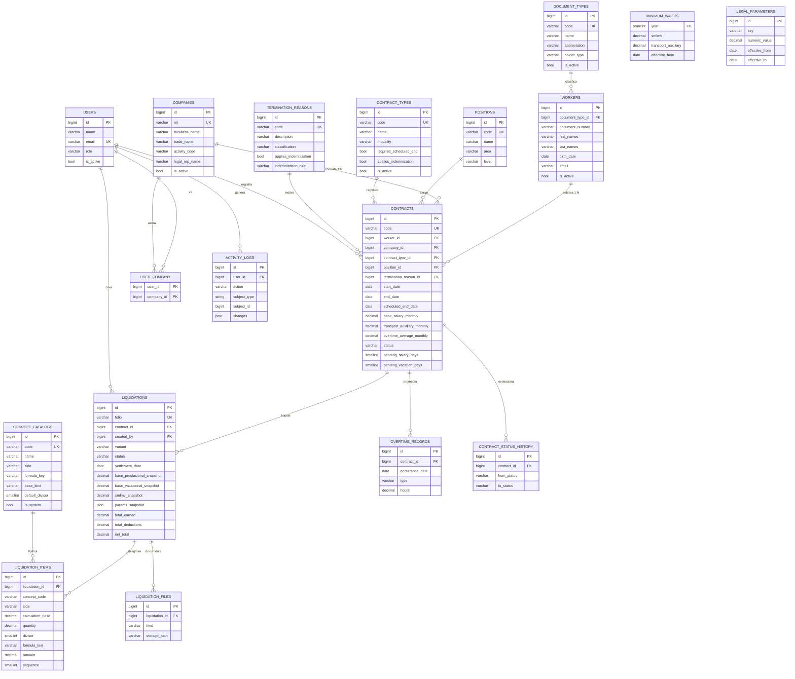

# Documento 3 — Diseño técnico

**Proyecto:** Sistema de Liquidación de Prestaciones Sociales · Laravel 13 + React (Inertia) + Tailwind 4

> Este documento responde a: **¿con qué se construye, dónde vive cada archivo y cómo se ve la base de datos?**
> Está ordenado como una receta: si se siguen las secciones de arriba a abajo, el proyecto queda montado.

---

## 1. Stack elegido y por qué

| Pieza           | Elección                                                                     | Por qué esta y no otra                                                                                                                                                                                                                                     |
| --------------- | ---------------------------------------------------------------------------- | ---------------------------------------------------------------------------------------------------------------------------------------------------------------------------------------------------------------------------------------------------------- |
| Lenguaje        | **PHP 8.5.12** (el de Laravel Herd)                                          | Laravel 13 lo pide; Herd ya lo trae con todas las extensiones activadas.                                                                                                                                                                                   |
| Backend         | **Laravel 13.39** (proyecto `blindem`)                                       | Lo pide el enunciado. Migraciones, validación, políticas y colas ya resueltos.                                                                                                                                                                             |
| Frontend        | **React 19 con TypeScript**, montado sobre **Inertia 3**                     | Es el entorno que se domina, y con Inertia no hace falta escribir una API: el controlador Laravel sigue existiendo, solo que en vez de devolver una vista devuelve datos y la página React los pinta.                                                      |
| CSS             | **Tailwind CSS 4.1** + una capa propia en `resources/css/app.css`            | El kit ya trae Tailwind. Los tokens de color y las sombras neomorfas viven en un solo archivo, y los ~40 componentes del kit los heredan sin tocarlos.                                                                                                     |
| Componentes     | **shadcn/ui** (Radix + `lucide-react`), los que trae el kit                  | Radix ya implementa ARIA, navegación por teclado y gestión de foco. Eso es accesibilidad real, no la que se escribe a mano y se olvida.                                                                                                                    |
| Base de datos   | **PostgreSQL 18.6** (servicio local) · **pgAdmin** para revisarla            | Motor relacional completo y único para desarrollo y pruebas: claves foráneas reales, `CHECK`, `EXCLUDE` con GiST, `jsonb` e índices parciales. El enunciado lo permite explícitamente y evita el "depende del motor".                                      |
| Autenticación   | La del starter kit (React) + passkeys                                        | Login, registro, verificación, 2FA y perfil ya hechos y probados. Reescribirlos a mano no aporta nada a esta prueba.                                                                                                                                       |
| Autorización    | Campo `role` + **Policies** + middleware                                     | Dos roles no justifican un paquete de permisos.                                                                                                                                                                                                            |
| Excel           | **`phpoffice/phpspreadsheet`** usado en directo                              | El formato del cliente es una hoja fija de cinco columnas: un envoltorio tipo `maatwebsite/excel` añade una capa de abstracción que no ahorra nada, y las pruebas necesitan abrir el archivo que sale para comparar celda por celda (§9).                  |
| PDF / impresión | **Hoja de estilos de impresión** (`@media print` en `resources/css/app.css`) | La pantalla `liquidaciones/show.tsx` ya es el documento: al imprimir desde el navegador queda el mismo diseño con los dos bloques de firma, y el XLSX es el archivo que se entrega. No hace falta generar un PDF en el servidor para cumplir el enunciado. |
| Tests           | **PHPUnit 12** con `RefreshDatabase` sobre `blindem_test`                    | Los dos casos del Excel tienen que salir al peso exacto, y las pruebas de dominio corren sin tocar la base.                                                                                                                                                |
| Versiones       | **GitHub**                                                                   | El enunciado lo exige.                                                                                                                                                                                                                                     |

**Qué quedó fuera y por qué:** Livewire y MaryUI (son la alternativa a React, no un complemento: ver §4.1), Docker, Redis y colas. Menos piezas móviles, más tiempo para el motor de cálculo, que es donde esta prueba se gana o se pierde.

---

## 2. Instalación (HECHA el 31/10/2026 — esto ya está en la máquina local)

### 2.0 Qué se instaló y qué se encontró

Al empezar no había `php`, `composer` ni `psql` en el PATH. Se instalaron y **apareció algo mejor**:

| Herramienta      | Estado                                                                            | Detalle                                                                                                                                                                          |
| ---------------- | --------------------------------------------------------------------------------- | -------------------------------------------------------------------------------------------------------------------------------------------------------------------------------- |
| **Laravel Herd** | ✔ **ya estaba instalado** y nadie lo había dicho                                  | `C:\Users\Usuario\.config\herd\bin\` · es el primero del PATH de usuario                                                                                                         |
| PHP              | ✔ **8.5.12 (Herd)** — este es el que hay que usar                                 | `...\herd\bin\php85\php.exe` · su `php.ini` trae `mbstring, curl, openssl, fileinfo, bcmath, intl, zip, gd, dom, OPcache` y los tres drivers de PDO (`pgsql`, `sqlite`, `mysql`) |
| Composer         | ✔ 2.10.3 (el de Herd: `herd\bin\composer.phar`)                                   |                                                                                                                                                                                  |
| Laravel          | ✔ proyecto **`blindem`** con Laravel **13.39.0** + starter kit **React**          | `D:\work\pruebatecnicajohnKennedy\blindem`                                                                                                                                       |
| Node             | ✔ v24.22.0 · npm 11.19.1                                                          | Hace falta para Vite (`npm run dev`). No se instaló entonces: ya estaba                                                                                                          |
| Base de datos    | ✔ **PostgreSQL 18.6** como servicio de Windows (`postgresql-x64-18`, puerto 5432) | `C:\Program Files\PostgreSQL\18\bin\psql.exe` · se revisa con **pgAdmin 4** · Ver §2.3                                                                                           |

**Lo que se desinstaló el 31/10 y por qué.** Para montar el entorno se instaló PHP 8.3 por winget y un
`composer.phar` propio en `AppData\Local\Programs\composer`, sin saber que Herd ya traía los dos. Como
el PATH de Herd va primero, esas instalaciones quedaban eclipsadas: comandos que aparentemente funcionaban
pero con un binario distinto al que se creía estar usando. Peor escenario para trabajar: editar un
`php.ini` que no aplica. `winget uninstall --id PHP.PHP.8.3`, borradas las dos carpetas y quitadas sus dos
entradas del PATH de usuario. Ahora hay **un solo PHP en la máquina**, y es el de Herd.

**Nunca se deben abrir dos terminales con PHP distinto.** Para comprobar cuál está en uso:

```bash
which php && php -v          # debe decir 8.5.12 y la ruta .config\herd\bin\php85
```

En una terminal **nueva** (el PATH solo se refresca al abrir una sesión nueva).

### 2.1 Comandos del día a día

```bash
cd D:/work/pruebatecnicajohnKennedy/blindem

composer run dev                     # artisan serve + queue + Vite + pint, en paralelo
php artisan migrate:fresh --seed     # reconstruir BD con datos de prueba
php artisan test                     # los golden tests del Excel
php artisan db:show                  # confirma que la conexión activa es blindem (pgsql)
npm run build                        # assets de producción (antes de commitear)
```

Si se levanta solo `php artisan serve` y se olvida Vite, la pantalla sale **sin estilos** (el HTML no
encuentra `hot`/`build`). Es el error que se va a repetir, así que va aquí en el paso 1.

### 2.2 Base de datos: crear el proyecto desde cero otra vez

```bash
laravel new blindem --react --database=pgsql   # instalador de Herd; deja todo montado
cd blindem
composer require phpoffice/phpspreadsheet zircote/swagger-php
composer require --dev larastan/larastan
composer run dev
```

`phpoffice/phpspreadsheet` es el que escribe el `.xlsx` (§9) y `zircote/swagger-php` el que lee los
atributos de `app/OpenApi/` y arma la especificación. No se instaló `maatwebsite/excel` ni `dompdf`: la
primera es una capa sobre PhpSpreadsheet que obliga a pasar por una vista Blade, y la segunda no la pidió
nadie en el enunciado. `larastan` es la extensión de PHPStan para Laravel; sin ella no analiza contenedores
ni fachadas.

### 2.3 PostgreSQL: rol, bases y conexión

La base de datos es **PostgreSQL 18.6 en local**, no un archivo incrustado. Eso cambia dos cosas
respecto a SQLite: hay un servidor que hay que tener levantado, y hay un **rol** con contraseña. La cadena
de conexión es corta y conviene tenerla clara: el archivo `.env` pone los valores, `config/database.php`
los lee con `env()` y arma el arreglo del conectador `pgsql`, `Illuminate` abre la conexión con PDO
(`pdo_pgsql`) contra el `DB_HOST:DB_PORT`, y Postgres decide si deja entrar mirando `pg_hba.conf`, que en
Windows vive dentro de `data/` del clúster. Si ahí el método para las conexiones de host local es `scram-sha-256`
o `md5`, la contraseña existe aunque la aplicación no la use a mano; una contraseña vacía con ese método
produce el error `fe_sendauth: no password supplied` al primer `php artisan migrate`, y es lo primero que
hay que revisar cuando todo lo demás parece correcto. Los pasos, el `pg_hba.conf`, el archivo `.env`,
`config/database.php` y la tabla de errores:

```sql
-- Como superusuario `postgres`, una sola vez, desde pgAdmin o desde psql:
CREATE ROLE blindem WITH LOGIN PASSWORD 'blindem';
CREATE DATABASE blindem      OWNER blindem;
CREATE DATABASE blindem_test OWNER blindem;
```

Y en `blindem/.env`:

```dotenv
DB_CONNECTION=pgsql
DB_HOST=127.0.0.1
DB_PORT=5432
DB_DATABASE=blindem
DB_USERNAME=blindem
DB_PASSWORD=blindem
```

Después de tocar el `.env`, `php artisan config:clear` (Laravel cachea la configuración y sigue
conectando a la base anterior). Con eso `php artisan migrate --seed` construye el esquema de §5.

**Dos bases, no una.** `blindem` es la de desarrollo y `blindem_test` la que usan las pruebas
(`phpunit.xml` fija `DB_CONNECTION=pgsql` y `DB_DATABASE=blindem_test`). `RefreshDatabase` borra y
reconstruye `blindem_test` en cada corrida; si apuntara a `blindem`, cada `php artisan test`
destruiría los contratos de demostración que se usan para grabar el video.

**Rol dedicado, no `postgres`.** El usuario de la aplicación es dueño de sus dos bases, por lo que puede
instalar las extensiones que necesitan las migraciones (`btree_gist`, `pg_trgm`: ambas están marcadas
`trusted` en su `.control`, así que no se necesita superusuario) y no tiene permisos de superusuario si
algún día se filtra la contraseña del `.env`.

### 2.4 Reglas al escribir migraciones sobre Postgres

Portabilidad ya no es una restricción: hay un solo motor. Lo que sí hay que respetar es el modo en que
Postgres se comporta distinto de lo que la documentación de Laravel asume por defecto.

| Regla                                                                                                                                              | Motivo                                                                                                                                                                                                                                                                                                                                                                                                                                                                                                |
| -------------------------------------------------------------------------------------------------------------------------------------------------- | ----------------------------------------------------------------------------------------------------------------------------------------------------------------------------------------------------------------------------------------------------------------------------------------------------------------------------------------------------------------------------------------------------------------------------------------------------------------------------------------------------- |
| `string(24)` + PHP `enum` en `casts()`, con el `CHECK` escrito en la migración                                                                     | Un `ENUM` de Postgres es un tipo propio: agregar un valor requiere `ALTER TYPE`, y las migraciones de Laravel no lo administran bien. Con `VARCHAR` + `CHECK` el catálogo sigue cerrado por la base.                                                                                                                                                                                                                                                                                                  |
| `->constrained()` sin cascada salvo donde el hijo no signifique nada sin el padre                                                                  | `constrained()` no agrega cláusula y Postgres aplica su default (`NO ACTION`, que en la práctica es `RESTRICT`): intentar borrar un trabajador con contratos deja un error claro en vez de una cascada que borra la historia.                                                                                                                                                                                                                                                                         |
| Los `CHECK` se agregan con `DB::statement("ALTER TABLE ... ADD CONSTRAINT ck_... CHECK (...)")` en un `foreach` justo después del `Schema::create` | El constructor de esquemas de Laravel 13.39 **no tiene verbo `check()`**: llamar `$table->check(...)` lanza `Error: Call to undefined method Blueprint::check()` al correr `php artisan migrate`, no al escribir el archivo. La restricción igual vive en la migración, con nombre propio (`ck_c_status`), para que el error de Postgres diga cuál se violó. `pg_dump` las imprime dentro del `CREATE TABLE`, así que en el apéndice §5.4 se ven inline aunque la migración las agregue por separado. |
| `$table->unique([...], 'nombre')` e `$table->index([...], 'nombre')` con nombre explícito                                                          | En Postgres se cumplen de verdad y el esquema depende de ellos, no de una validación de formulario que se puede saltar por otra ruta. Nombrarlos es lo que permite que el error devuelva `uq_worker_doc` en vez de un `contracts_worker_id_fkey` generado a mano por la base.                                                                                                                                                                                                                         |
| `->decimal(14, 2)` y nada de `float`                                                                                                               | Postgres guarda `NUMERIC` exacto. Un `double precision` redondea el dinero en binario y es exactamente el error que las pruebas del Excel buscan.                                                                                                                                                                                                                                                                                                                                                     |
| `DB::statement()` para `EXCLUDE`, GIN y índices sobre expresiones                                                                                  | El constructor de esquemas no tiene verbos para ellas.                                                                                                                                                                                                                                                                                                                                                                                                                                                |
| `whereDate()` en los rangos de vigencia                                                                                                            | Eloquent guarda la fecha como `'2021-01-01 00:00:00'`; comparar con `where()` deja fuera el primer día de vigencia, que es el día en que el SMLMV ya cambió.                                                                                                                                                                                                                                                                                                                                          |

Cada migración con SQL crudo arranca con `if (DB::connection()->getDriverName() !== 'pgsql') return;`. No es
para soportar otro motor: es para que `php artisan migrate` en una máquina con otra base no reviente a la
mitad del esquema, dejando tablas creadas y la constraint `EXCLUDE` sin aplicar.

---

## 3. Estructura de carpetas

````
blindem/
├── app/
│   ├── Domain/                        EL MOTOR. Sin HTTP, sin SQL.
│   │   ├── Calculation/
│   │   │   ├── LiquidationEngine.php           orquesta el cálculo de principio a fin
│   │   │   ├── WorkedDaysCalculator.php        días comerciales, naturales y del plazo restante
│   │   │   ├── SalaryBaseBuilder.php           base prestacional y base vacacional
│   │   │   ├── Parameters.php                  parámetros legales por fecha y por clave
│   │   │   ├── LiquidationDraft.php            lo que digita el usuario
│   │   │   ├── Contracts/                      ConceptCalculator · IndemnizationStrategy
│   │   │   ├── Calculators/                    nueve clases, una por fórmula
│   │   │   │   ├── CesantiasCalculator.php            PrimaCalculator.php
│   │   │   │   ├── InteresesCesantiasCalculator.php   VacacionesCalculator.php
│   │   │   │   ├── SalarioPendienteCalculator.php      AuxilioTransporteCalculator.php
│   │   │   │   ├── SocialSecurityContributionCalculator.php   salud y pensión
│   │   │   │   ├── ManualValueCalculator.php       renglón cuyo valor se digita
│   │   │   │   └── IndemnizacionCalculator.php
│   │   │   ├── Indemnization/                  las cinco clases del art. 64
│   │   │   │   ├── IndemnizationStrategyFactory.php
│   │   │   │   ├── ProportionalByYears.php     abstracta: primer año + años + fracción
│   │   │   │   ├── IndefinidoMenos10Smlmv.php  literal a (30 + 20)
│   │   │   │   ├── IndefinidoMas10Smlmv.php    literal b (20 + 15)
│   │   │   │   ├── TerminoFijoPlazoRestante.php
│   │   │   │   └── SinIndemnizacion.php
│   │   │   └── Dto/                            Computation · ComputedLines · DayCounts ·
│   │   │                                       IndemnizableDays · SalaryBases ·
│   │   │                                       SalaryBaseAssembly · Tenure ·
│   │   │                                       LiquidationContext · LiquidationLine ·
│   │   │                                       LiquidationResult
│   │   ├── Contracts/                   LOS PUERTOS: interfaces, sin SQL.
│   │   │   ├── ConceptCatalogRepository.php    LegalParameterRepository.php
│   │   │   ├── LiquidationRepository.php       MinimumWageRepository.php
│   │   ├── ValueObjects/               Money · WageSet · ConceptDefinition ·
│   │   │                               ConceptList · LiquidationReceipt
│   │   ├── Enum/                       dieciséis enums, cada uno espeja un CHECK de la base
│   │   │   ├── ConceptSide.php  BaseKind.php  HolderType.php  Gender.php
│   │   │   ├── ContractModality.php  ContractStatus.php  IndemnizationRule.php
│   │   │   ├── TerminationClassification.php  ParameterUnit.php  OvertimeType.php
│   │   │   ├── TransportAuxiliaryMode.php  LiquidationVariant.php  LiquidationStatus.php
│   │   │   └── LiquidationFileKind.php  ActivityAction.php  UserRole.php
│   │   └── Exceptions/                 ParameterNotConfigured · WageNotConfigured ·
│   │                                   ContractNotLiquidatable
│   ├── Application/
│   │   └── LiquidationDraftMapper.php  contrato + formulario → borrador del motor; sugiere
│   │                                   la variante y la regla de indemnización
│   ├── Infrastructure/                 LA CONEXIÓN. Aquí, y solo aquí, hay SQL.
│   │   ├── Persistence/Eloquent/       EloquentConceptCatalogRepository,
│   │   │                               EloquentLegalParameterRepository,
│   │   │                               EloquentLiquidationRepository,
│   │   │                               EloquentMinimumWageRepository
│   │   ├── Auditing/ActivityLogger.php escribe la bitácora en activity_logs
│   │   └── Export/LiquidationWorkbookExporter.php  XLSX de dos hojas con PhpSpreadsheet
│   ├── Http/
│   │   ├── Controllers/                DashboardController, WorkerController, CompanyController,
│   │   │                               ContractController, LiquidationController (index, create,
│   │   │                               preview, store, show, excel), ParametricController,
│   │   │                               ApiDocsController y Settings/
│   │   │   ├── Middleware/             EnsureUserIsAdmin · HandleInertiaRequests · HandleAppearance
│   │   ├── Parametrics/                ParametricRegistry · ParametricDefinition ·
│   │   │                               ParametricField · FieldType
│   │   ├── Presenters/                 WorkerPresenter · CompanyPresenter · ContractPresenter ·
│   │   │                               LiquidationPresenter · LiquidationGuidePresenter
│   │   └── Requests/                   WorkerRequest · CompanyRequest · ContractRequest ·
│   │                                   StoreLiquidationRequest · ParametricRequest
│   ├── Models/                         diecisiete, uno por tabla: cast, relaciones y etiquetas
│   ├── OpenApi/                        atributos que generan la especificación OpenAPI 3.1
│   ├── Policies/                       WorkerPolicy · CompanyPolicy · ContractPolicy ·
│   │                                   LiquidationPolicy
│   └── Providers/AppServiceProvider.php  aquí el contenedor une puerto con adaptador
├── database/
│   ├── migrations/  seeders/  factories/
├── resources/
│   ├── css/app.css                     los tokens y el neumorfismo (§4.5)
│   ├── js/
│   │   ├── app.tsx                     createRoot y el layout por defecto
│   │   ├── routes/                     lo genera Wayfinder; está en .gitignore
│   │   ├── layouts/                    app/ · auth/ · settings/
│   │   ├── components/ui/              button, table, dialog, input…
│   │   ├── components/app-sidebar.tsx  navegación por rol
│   │   ├── hooks/  lib/  types/
│   │   └── pages/
│   │       ├── dashboard.tsx  auth/  settings/
│   │       ├── workers/  companies/  contracts/        index.tsx + form.tsx
│   │       ├── parametrics/                            index.tsx + form.tsx: una sola pantalla
│   │       │                                           para los cinco catálogos
│   │       └── liquidations/                           index.tsx · create.tsx · show.tsx
│   └── views/                          app.blade.php (el shell que monta Inertia)
│                                       api-docs/ui.blade.php (Swagger UI)
├── routes/web.php
└── tests/Feature/  tests/Unit/         los golden tests del Excel

**Regla práctica:** si una clase hace matemática de liquidación, va en `app/Domain`. Si toca HTTP, va en
`app/Http`. Si escribe SQL, va en `app/Infrastructure`. Nunca al revés.

El MVC del kit se mantiene entero, solo que con una capa más en el medio. El recorrido de una petición de
liquidación, en orden:

1. **Ruta** `routes/web.php` → `POST /contratos/{contract}/liquidar`, y la hermana
   `POST /contratos/{contract}/liquidar/vista-previa`, ambas detrás del middleware de sesión y de rol.
2. **Controller** `LiquidationController@store` y `@preview` pasan el request al `FormRequest`, le piden
   al mapeador el borrador y llaman al motor. No hacen aritmética y no escriben una consulta.
3. **Aplicación** `LiquidationDraftMapper::fromContract()` convierte la fila del contrato más lo que se
   digitó en un `LiquidationDraft`, y decide la variante sugerida y la regla de indemnización.
4. **Dominio** `LiquidationEngine::calculate($borrador)` arma el contexto, recorre el catálogo en orden y
   produce un `LiquidationResult` con sus renglones. Aquí están `Money`, los `enum` y las reglas de los
   360/720 días. Esta carpeta **no importa nada de `Illuminate`**: sus dependencias hacia afuera son
   interfaces.
5. **Puerto** `LegalParameterRepository`, `MinimumWageRepository` y `ConceptCatalogRepository`, declaradas
   en `app/Domain/Contracts`. El dominio dice qué necesita, no cómo se obtiene.
6. **Adaptador** `EloquentLegalParameterRepository` y compañía, en `app/Infrastructure/Persistence/Eloquent`,
   sí importan modelos Eloquent y arman el `whereDate` de vigencia. Traducen fila en objeto de valor.
7. **Vista** el controlador redirige o responde JSON, e Inertia pinta `pages/liquidations/create.tsx` o
   `pages/liquidations/show.tsx`. De Blade solo quedan dos archivos: `views/app.blade.php`, el shell que monta la
   aplicación React, y `views/api-docs/ui.blade.php`, la página de Swagger. La impresión es CSS sobre la propia
   pantalla (`print:hidden` en lo que no se imprime), así que el documento firmado sale de la misma vista que se ve.

El eslabón que une 5 con 6 es el contenedor: cuatro líneas `singleton` en `AppServiceProvider::register()`.
Gracias a eso, cambiar Postgres por otro medio no toca una sola clase de `app/Domain`, y las pruebas del
motor se corren instanciando un repositorio de memoria en lugar del Eloquent — que es lo que permite que
`MoneyTest` pase sin base de datos abierta.

---

## 4. Frontend — React con Inertia, y el tema de diseño de Blindem

### 4.1 Primero: MaryUI y React no van juntos

Releyendo el enunciado, pide *"backend y frontend en Laravel con paquetes de interfaz tipo MaryUI, Bootstrap o similares"*. Esos tres nombres son **tres caminos distintos**, no tres capas que se apilan:

| Camino | Qué es | ¿Se puede mezclar con React? |
|---|---|---|
| **MaryUI** | Librería de componentes para **Livewire** (Blade + PHP). Todo el estado vive en el servidor. | **No.** MaryUI no exporta componentes React; se escribe `<x-button>` en una vista Blade. |
| **Bootstrap** | CSS y JS del DOM, sin framework de componentes. | Se puede, pero peleándose: Bootstrap manipula el DOM con jQuery/JS propio y React re-renderiza ese mismo DOM. |
| **Inertia + React** | Laravel sigue siendo el backend; el kit oficial `--react` monta React 19 + Tailwind 4 + shadcn/ui. | Es el camino elegido, porque React es el entorno donde se rinde de verdad. |

Así que la decisión es una de dos, y cayó en la segunda: **o Livewire con MaryUI, o React con Tailwind**. El enunciado cierra con *"o similares"*, y el starter kit de React es el primero que lista Laravel en sus documentos oficiales, así que el requisito de "Laravel con paquetes de interfaz" se cumple igual. En el README del repo esa justificación va escrita, porque es la primera pregunta que le va a surgir a quien revise el código: *"¿por qué React si el correo mencionaba MaryUI?"*.

Y una cosa más, importantísima para el esfuerzo: **con Inertia no hace falta escribir una API**. No hay `fetch`, no hay JWT, no hay CORS, no hay estados de carga manuales. El controlador es Laravel normal:

```php
// routes/web.php
Route::inertia('/contratos', 'contracts/index', [
    'contracts' => fn () => Contract::with('worker', 'company')->paginate(15),
]);
````

`Route::inertia` con una closure: la propiedad diferida solo se calcula cuando el usuario llega a la página 1. El navegador recibe HTML con los datos ya dentro, y React los hidrata. Si JavaScript falla, la primera pantalla igual se ve.

### 4.2 Los dos comandos que levantan la app

Con React el entorno tiene dos procesos, no uno. El kit lo resuelve con un solo comando:

```bash
composer run dev     # levanta servidor + cola + Vite + rebuild de Pint, todo a la vez
```

En Windows, con Herd, eso corre `php artisan serve` y `npm run dev` en paralelo. Mientras se escribe código
hacen falta los dos; si solo se levanta el de PHP, la pantalla sale sin estilos porque Vite no generó los
`assets`. Ese error se va a ver más de una vez, así que queda anotado aquí.

### 4.3 Los seis patrones que resuelven toda la interfaz

| Necesidad                 | Componente del kit                                                                                       | ¿Lleva JS propio?                                       |
| ------------------------- | -------------------------------------------------------------------------------------------------------- | ------------------------------------------------------- |
| Listado de contratos      | `<Table>` de shadcn + `<Pagination>` que ya viene en el kit                                              | No                                                      |
| **Filtrado dinámico**     | `<Select>` + `<Input>` dentro de un `router.reload({ data, preserveScroll: true, only: ['contracts'] })` | Un `useEffect` con debounce, nada más                   |
| Crear/editar catálogo     | `<Dialog>` con `<Form>` (Inertia) y `onError` para pintar los mensajes de Laravel                        | No hay que escribir manejo de errores: Inertia los trae |
| Resultado de liquidación  | `<Card>` con la tabla de 5 columnas + el total en `<CardFooter>`                                         | No                                                      |
| Botón "Liquidar"          | `<Button variant="taxi">`, la variante neomorfa propia (§4.5)                                            | No                                                      |
| Estados vacíos y de carga | `<Skeleton>` re-estilizado + ilustración propia                                                          | No                                                      |

> **"Filtrado dinámico" no significa Ajax.** Significa que los filtros se combinan y se aplican al vuelo.
> Con Inertia eso es `router.reload({ only: ['contracts'] })`: se pide al servidor **solo** la porción de datos
> que cambió, sin recargar la página y sin escribir un endpoint raro. En la sustentación esto se defiende solo.

### 4.4 La fórmula del motor en la pantalla

```tsx
<Table>
    <TableHeader>
        <TableRow>
            <TableHead>Concepto</TableHead>
            <TableHead>Base de cálculo</TableHead>
            <TableHead>Días / Cantidad</TableHead>
            <TableHead>Fórmula aplicada</TableHead>
            <TableHead className="text-right">Valor a pagar</TableHead>
        </TableRow>
    </TableHeader>
    <TableBody>
        {result.earnings.map((line) => (
            <TableRow key={line.code}>
                <TableCell className="font-medium">{line.name}</TableCell>
                <TableCell className="tabular">
                    {formatCOP(line.base)}
                </TableCell>
                <TableCell className="tabular">{line.quantity}</TableCell>
                <TableCell className="font-mono text-xs text-muted-foreground">
                    {line.formula}
                </TableCell>
                <TableCell className="neu-figure tabular text-right">
                    {formatCOP(line.amount)}
                </TableCell>
            </TableRow>
        ))}
    </TableBody>
    <TableFooter>
        <TableRow>
            <TableCell colSpan={4} className="text-right font-semibold">
                TOTAL DEVENGADO (A)
            </TableCell>
            <TableCell className="neu-figure tabular text-right">
                {formatCOP(result.totalEarned)}
            </TableCell>
        </TableRow>
    </TableFooter>
</Table>
```

Las 5 columnas son **literalmente** las del Excel, en el mismo orden. Eso es lo que mira el evaluador, y es la razón por la que `formula` viaja como texto desde el motor: si el renglón no puede explicar cómo se calculó, no sirve.

### 4.5 El tema de Blindem: taxi, gris y negro

Blindem no tiene manual de marca, así que se armó uno chiquito y quedó escrito, porque es más fácil defender cuatro reglas que defender un gusto.

Los colores son tres familias y cada una tiene un trabajo que no comparte:

- **Amarillo taxi** `#FFC400`, que en realidad es un degradado `#FFD22A → #FFC400 → #FF9A1E` (de ahí el aire naranja). Solo se usa como **superficie de botón, indicador de selección y número importante**. Nunca como color de texto en modo claro.
- **Gris** `#E9EBEE` de superficie en modo claro, `#22262C` en las tarjetas del modo oscuro.
- **Negro grafito** `#16191D` como fondo del modo oscuro y como texto del modo claro.

Todo eso vive en **variables CSS con nombre** (`--color-taxi`, `--neu-raised`, `--gradient-taxi`), que es lo
que se llama un _token_: en vez de repetir `#ffc400` en cuarenta lados, se escribe `var(--color-taxi)` y si al
cliente no le gusta el amarillo se edita **una línea**. El archivo es `resources/css/app.css`, y va limpio de
comentarios: los ratios de contraste medidos quedan en la tabla de más abajo, que es donde van a buscarse
antes de tocar un color, y no en un `/* */` que el formateador borra.

El arreglo de tokens del kit (`--background`, `--card`, `--primary`, `--ring`, `--sidebar-*`) está reescrito
entero, y ahí está el truco que evitó tocar los cuarenta componentes. El bloque siguiente es un resumen
anotado de `resources/css/app.css` —en el archivo real no hay ni un comentario, así que las notas van acá:

```css
:root {
    --background: #e9ebee;
    --foreground: #14171b;
    --primary: #ffc400;
    --primary-foreground: #0e1116;
    --muted-foreground: #5b6472;
    --ring: #8a5a00;
    --radius: 1.1rem;

    --neu-dark: rgba(163, 177, 192, 0.55);
    --neu-light: rgba(255, 255, 255, 0.95);
    --neu-raised: 7px 7px 16px var(--neu-dark), -7px -7px 16px var(--neu-light);
    --neu-sunken:
        inset 5px 5px 10px var(--neu-dark),
        inset -5px -5px 10px var(--neu-light);
    --gradient-taxi: linear-gradient(
        135deg,
        #ffd22a 0%,
        #ffc400 42%,
        #ff9a1e 100%
    );
}

@theme {
    --shadow-xs: var(--neu-raised);
    --shadow-sm: var(--neu-raised-lg);
}

@layer components {
    .bg-primary,
    .bg-sidebar-primary {
        background-image: var(--gradient-taxi);
    }

    .neu-card {
        background: var(--card);
        border-radius: var(--radius-lg);
        box-shadow: var(--neu-raised-lg);
    }
    .neu-sunken {
        background: var(--input);
        box-shadow: var(--neu-sunken);
    }

    .btn-taxi {
        background-image: var(--gradient-taxi);
        color: #0e1116;
        font-weight: 600;
        border-radius: var(--radius-lg);
        box-shadow:
            var(--neu-raised),
            0 2px 0 rgba(138, 90, 0, 0.35);
        transition:
            transform 180ms cubic-bezier(0.2, 0.8, 0.2, 1),
            box-shadow 180ms cubic-bezier(0.2, 0.8, 0.2, 1);
    }
    .btn-taxi:hover {
        transform: translateY(-2px);
        box-shadow:
            var(--neu-raised-lg),
            0 4px 0 rgba(138, 90, 0, 0.35);
    }
    .btn-taxi:active {
        transform: translateY(1px);
        box-shadow: var(--neu-pressed);
    }
}
```

Cuatro lecturas de ese bloque, que son las que lo hacen corto:

- `--foreground: #14171b` marca **15.05:1** sobre el fondo gris, y `--primary-foreground` es negro y no
  blanco: texto negro sobre taxi da **11.84:1**; blanco sobre taxi daría 1.60:1.
- `--ring: #8a5a00` — el anillo de foco es ocre oscuro, no amarillo, para que se vea también sobre el propio
  botón taxi.
- Redirectir `--shadow-xs` y `--shadow-sm` dentro de `@theme` hace que los utilities `shadow-xs` del kit —
  Botón, Tarjeta, Input, Dialog— salgan con relieve sin reescribir ningún componente.
- `.bg-primary { background-image: ... }` no pelea con Tailwind: el pintaba `background-color` y encima se le
  agrega `background-image`. Especificidad igual, resultado degradado.

El bloque `.dark { ... }` hace lo mismo sobre negro grafito, y ahí es donde el taxi rinde: sobre `#16191D` el amarillo marca **11.41:1**, que es el mejor contraste de toda la interfaz. El kit arranca en `system` (respeta lo que pidió el usuario en su navegador) y el interruptor Sistema / Claro / Oscuro vive en Ajustes → Apariencia; como todos los componentes consumen variables, cambiar de tema no requiere tocar ni un `.tsx`.

Comprobado en el navegador, no en la teoría: `npm run build` compila los tokens, y en Ajustes → Perfil el
botón "Guardar" sale con el degradado taxi y texto negro, las cajas de texto hundidas y la tarjeta de aviso
en rojo con su propio relieve. Las diagonales que se ven en el dashboard vacío son el placeholder que trae el
kit.

### 4.6 Neumorfismo que no reprueba accesibilidad

El neumorfismo comunica volumen con sombras suaves sobre un fondo casi del mismo color. Justo lo contrario de lo que exige WCAG, que quiere que el texto y los controles se distingan **por color**, no por sombra. Entonces se midió, con la fórmula de luminancia relativa de WCAG 2.1, cada par de la paleta. Los cuatro errores que se cometen con amarillo y gris, y cómo quedaron cerrados:

| Lo que se intentaría                 | Ratio           | Regla aplicada                                                                                                                                                                                                                       |
| ------------------------------------ | --------------- | ------------------------------------------------------------------------------------------------------------------------------------------------------------------------------------------------------------------------------------ |
| Texto blanco sobre botón taxi        | **1.60:1**      | Prohibido. El botón taxi lleva texto `#0E1116` → **11.84:1**. Sobre el extremo naranja `#FF9A1E` el negro baja a 8.02:1, sigue pasando.                                                                                              |
| Texto amarillo taxi sobre gris claro | **1.34:1**      | El taxi nunca es texto. Para escribir en amarillo se usa `--color-taxi-ink` `#8A5A00` → **4.96:1** en claro; en oscuro sí se puede usar `#FFD22A` → 11.41:1.                                                                         |
| Fondo blanco puro                    | —               | Sobre blanco puro la sombra gris desaparece: no hay relieve y el texto suave se vuelve ilegible. La base es gris `#E9EBEE`; el blanco se reserva para la cara iluminada.                                                             |
| Estado señalado solo con sombra      | 1.41:1 el borde | Ningún estado depende de la sombra: el foco es un anillo sólido (`outline: 2px solid var(--ring)`), la badge dice "Aprobada" con palabras, y `@media (forced-colors: active)` reemplaza todos los relieves por bordes negros reales. |

Y las tres capas que hacen que esto se vea profesional y no decorativo:

```css
/* 1. Skeletons en vez de spinners: una caja hundida con un brillo que cruza */
.skeleton-neu {
    position: relative;
    overflow: hidden;
    background: var(--muted);
    box-shadow: var(--neu-pressed);
}
.skeleton-neu::after {
    content: '';
    position: absolute;
    inset: 0;
    transform: translateX(-100%);
    background: linear-gradient(
        90deg,
        transparent,
        rgba(255, 196, 0, 0.28),
        transparent
    );
    animation: neu-shimmer 1.4s cubic-bezier(0.2, 0.8, 0.2, 1) infinite;
}

/* 2. Quien pidió menos movimiento no ve barridos ni saltos */
@media (prefers-reduced-motion: reduce) {
    .skeleton-neu::after,
    .neu-enter {
        animation: none;
    }
    .btn-taxi,
    .btn-taxi:hover,
    .btn-taxi:active {
        transition: none;
        transform: none;
    }
}

/* 3. El paz y salvo se imprime: sin relieves ni degradados, sin gastar tóner */
@media print {
    body {
        background: #fff;
    }
    .neu-card,
    .neu-raised,
    .btn-taxi {
        box-shadow: none;
        background-image: none;
    }
    nav,
    aside {
        display: none !important;
    }
}
```

En React, el `<Skeleton>` del kit se cambia con una línea en `resources/js/components/ui/skeleton.tsx`:
`className={cn('skeleton-neu', className)}`, y el mismo lleva `aria-hidden="true"`. Eso es deliberado: el
brillido es decorativo y un lector de pantalla no tiene nada que announce de ahí. Lo que sí anuncia es el
`<Spinner>` (`resources/js/components/ui/spinner.tsx`), que trae `role="status"` y `aria-label="Cargando"`;
cuando una zona está esperando datos, el texto accesible va en ese componente y no en el esqueleto.

Comprobaciones que hay que ver con los propios ojos antes de grabar el video:

- [ ] Zoom al 200 %: la tabla de cinco columnas no corta nada (envuelta en `overflow-x-auto`).
- [ ] Recorrer toda la pantalla **solo con `Tab`** y saber en cada paso dónde está el foco.
- [ ] DevTools → Accessibilidad → _Contraste_: todo en verde, incluidos los textos grises.
- [ ] Modo claro y modo oscuro se ven igual de consistentes (el interruptor está en Ajustes).

### 4.7 El documento imprimible, y por qué no hay un generador de PDF en el servidor

Blade queda en dos archivos y ninguno es una pantalla de negocio: `resources/views/app.blade.php`, el
esqueleto que monta la app React e Inertia y carga el CSS compilado, y `resources/views/api-docs/ui.blade.php`,
la página que levanta Swagger UI contra `spec.json`. Todo lo demás es React.

El documento que se imprime y que firma el trabajador **es la misma pantalla** `resources/js/pages/liquidations/show.tsx`.
El botón "Imprimir" llama a `window.print()` y la regla `@media print` del final de `resources/css/app.css` hace el
resto: fondo blanco, sombras neomorfas apagadas y `nav`/`aside` ocultos. Dentro del `<article>` —que es lo único que
sobrevive en el papel— el cierre lleva la "Declaración y firmas de conformidad" con el texto de paz y salvo y los dos
bloques de firma (Firma del trabajador con su documento, Empleador / representante legal con NIT y razón social),
tomados de `ContractPresenter::card()`. Lo que no interesa en papel está marcado con `print:hidden`: la barra de
botones, el desglose de parámetros congelados y la guía normativa en `<details>`. El mismo texto de paz y salvo vive
en el XLSX, en `LiquidationWorkbookExporter::signatures()`, para que los dos canales no se separen.

`barryvdh/laravel-dompdf` **no se instaló**, y es una decisión con motivo: dompdf necesita un HTML que exista en el
servidor, y con Inertia ese HTML se arma en el navegador, así que habría que escribir una segunda vista Blade con el
diseño duplicado y mantener las dos copias sincronizadas a mano cada vez que cambie un renglón. El enunciado pide un
documento para imprimir y un Excel; la pantalla con estilos de impresión cubre lo primero y el XLSX de dos hojas
(§9) cubre lo segundo —y además el Excel es el archivo que el cliente revisa celda por celda. El PDF descargable se
declaró fuera de alcance en RF-06.4 de `docs/01-requerimientos.md`, no se hizo a medias.

---

## 5. Base de datos

### 5.1 Diagrama entidad-relación



**El enunciado pide "Trabajador 1:N Empresa vía Contrato".** Eso se cumple así:
`WORKERS 1—* CONTRACTS *—1 COMPANIES`. `contracts` es la tabla **puente con datos propios**
(salario, fechas, cargo). Por eso la relación es N:M resuelta en dos 1:N, y por eso no hay una
tabla intermedia vacía `company_worker`.

### 5.2 Tablas (18)

#### Tablas paramétricas (catálogos) — las exige el enunciado

| #   | Tabla                 | Propósito                               | Claves       |
| --- | --------------------- | --------------------------------------- | ------------ |
| 1   | `document_types`      | CC, CE, NIT, PA…                        | `code` único |
| 2   | `positions`           | Cargos                                  | `code` único |
| 3   | `contract_types`      | Indefinido, término fijo, obra o labor… | `code` único |
| 4   | `termination_reasons` | Motivos de retiro                       | `code` único |
| 5   | `concept_catalogs`    | Los 11 renglones del Excel              | `code` único |
| 6   | `minimum_wages`       | SMLMV por año                           | `year` PK    |
| 7   | `legal_parameters`    | Tasas y topes con vigencia              | `key` único  |

#### Tablas maestras

| #   | Tabla       | Propósito                                                |
| --- | ----------- | -------------------------------------------------------- |
| 8   | `users`     | Cuenta + rol                                             |
| 9   | `workers`   | Datos personales del afiliado                            |
| 10  | `companies` | Empresas                                                 |
| 11  | `contracts` | ★ La relación trabajador-empresa con su salario y fechas |

#### Tablas de resultado

| #   | Tabla               | Propósito                                           |
| --- | ------------------- | --------------------------------------------------- |
| 12  | `liquidations`      | Cabecera de la liquidación + totales + snapshot     |
| 13  | `liquidation_items` | ★ Cada renglón: base, días, divisor, fórmula, valor |
| 14  | `liquidation_files` | Excel/PDF generados                                 |

#### Apoyo

| #   | Tabla                     | Propósito                                                  |
| --- | ------------------------- | ---------------------------------------------------------- |
| 15  | `user_company`            | Qué empresas ve cada colaborador                           |
| 16  | `overtime_records`        | Horas extras reales para _calcular_ el promedio (opcional) |
| 17  | `contract_status_history` | Traza de estados del contrato                              |
| 18  | `activity_logs`           | Auditoría                                                  |

### 5.3 DDL en español por tabla (léelo antes del SQL)

**`workers`** — no guarda empresa ni cargo: esos datos viven en `contracts`, porque un trabajador
cambia de empresa y de cargo, pero sigue siendo la misma persona.

**`contracts`** — es la tabla más importante. Guarda el `salario básico`, el `auxilio`, las `horas extras`,
las `fechas` y el `motivo`. Y `scheduled_end_date`, que el Excel no tiene y por eso no puede calcular
bien un término fijo.

**`liquidations`** — cabecera. Además de los totales, guarda `params_snapshot` (`jsonb`): una fotografía
de las tasas y del SMLMV que se usaron. Sin esto, si el SMLMV cambia mañana, las liquidaciones viejas
cambian de valor. Eso en un sistema real es inaceptable.

**`liquidation_items`** — una fila por renglón del Excel. Con `formula_text` se puede imprimir la columna
"Fórmula Aplicada" sin reconstruir nada, y se puede mostrar al administrador el detalle de un reclamo.

**`termination_reasons`** — lleva `applies_indemnization`. Así el sistema sabe si el Formato A o B,
**por catálogo y no por comparar texto**. Corrige el error #1 y #10 del Excel.

**`contract_types`** — lleva `modality` (enum) y `requires_scheduled_end`. Corrige el error #1.

**`minimum_wages`** — parametriza el SMLMV por año (hallazgo #2): el Excel lo tiene como celda digitada.

### 5.4 SQL (PostgreSQL 18) — cómo queda el esquema

El fuente de verdad son las migraciones de `database/migrations`: ellas son las que se ejecutan con
`php artisan migrate`. Este bloque es ese mismo esquema escrito en SQL directo y en el orden que Postgres
exige (extensiones, catálogos, maestras, resultado, apoyo), para poder leerlo de una sola pasada en
pgAdmin o pegarlo en el anexo del README. Terminada la instalación, `pg_dump --schema-only -d blindem`
regenera este texto desde la base real, así que sirve de control: si el `dump` y este bloque se
distancian, alguna migración se quedó atrás.

Dos cosas ya no están, porque eran requisitos de la portabilidad que se abandonó: `ENGINE=InnoDB`
(Postgres no tiene motores de almacenamiento) y los `KEY` dentro de `CREATE TABLE` (Postgres no los
acepta; los índices secundarios se crean con `CREATE INDEX` aparte, que es justo lo que hacen las
migraciones). El `ENUM` de MySQL tampoco: son `VARCHAR` + `CHECK`, y el tipo lo interpreta PHP con sus
`enums` en `casts()`.

```sql
-- ============ 0. EXTENSIONES ============
-- btree_gist permite mezclar = y && en el mismo EXCLUDE; pg_trgm da el índice de texto parcial.
-- Ambas son "trusted": el dueño de la base las instala sin ser superusuario.
CREATE EXTENSION IF NOT EXISTS btree_gist;
CREATE EXTENSION IF NOT EXISTS pg_trgm;

-- ============ 1. CATÁLOGOS ============
CREATE TABLE document_types (
  id BIGSERIAL PRIMARY KEY,
  code VARCHAR(8) NOT NULL,
  name VARCHAR(120) NOT NULL,
  abbreviation VARCHAR(16) NULL,
  holder_type VARCHAR(16) NOT NULL DEFAULT 'natural',
  is_active BOOLEAN NOT NULL DEFAULT TRUE,
  created_at TIMESTAMP NULL, updated_at TIMESTAMP NULL,
  CONSTRAINT uq_dt_code UNIQUE (code),
  CONSTRAINT ck_dt_holder CHECK (holder_type IN ('natural','juridica','both'))
);

CREATE TABLE positions (
  id BIGSERIAL PRIMARY KEY,
  code VARCHAR(16) NOT NULL, name VARCHAR(150) NOT NULL,
  area VARCHAR(80) NULL, level VARCHAR(40) NULL,
  is_active BOOLEAN NOT NULL DEFAULT TRUE,
  created_at TIMESTAMP NULL, updated_at TIMESTAMP NULL,
  CONSTRAINT uq_pos_code UNIQUE (code),
  CONSTRAINT uq_pos_name UNIQUE (name)
);

CREATE TABLE contract_types (
  id BIGSERIAL PRIMARY KEY,
  code VARCHAR(16) NOT NULL, name VARCHAR(150) NOT NULL,
  modality VARCHAR(24) NOT NULL,
  requires_scheduled_end BOOLEAN NOT NULL DEFAULT FALSE,
  statutory_max_months SMALLINT NULL,
  applies_indemnization BOOLEAN NOT NULL DEFAULT FALSE,
  indemnization_rule VARCHAR(24) NULL,
  is_active BOOLEAN NOT NULL DEFAULT TRUE,
  created_at TIMESTAMP NULL, updated_at TIMESTAMP NULL,
  CONSTRAINT uq_ct_code UNIQUE (code),
  CONSTRAINT ck_ct_modality CHECK (modality IN
    ('indefinido','termino_fijo','obra_o_labor','aprendizaje','ocasional','servicios')),
  CONSTRAINT ck_ct_rule CHECK (indemnization_rule IS NULL OR indemnization_rule IN
    ('art64_segun_salario','art64_lt_a','art64_lt_b','plazo_restante','ninguna')),
  CONSTRAINT ck_ct_months CHECK (statutory_max_months IS NULL OR statutory_max_months > 0)
);

CREATE TABLE termination_reasons (
  id BIGSERIAL PRIMARY KEY,
  code VARCHAR(16) NOT NULL, description VARCHAR(200) NOT NULL,
  classification VARCHAR(24) NOT NULL,
  applies_indemnization BOOLEAN NOT NULL DEFAULT FALSE,
  indemnization_rule VARCHAR(24) NOT NULL DEFAULT 'ninguna',
  applies_sanction_art65 BOOLEAN NOT NULL DEFAULT FALSE,
  is_active BOOLEAN NOT NULL DEFAULT TRUE,
  created_at TIMESTAMP NULL, updated_at TIMESTAMP NULL,
  CONSTRAINT uq_tr_code UNIQUE (code),
  CONSTRAINT ck_tr_class CHECK (classification IN
    ('voluntad_general','justa_causa','sin_justa_causa','vencimiento','mutuo_acuerdo','fallecimiento')),
  CONSTRAINT ck_tr_rule CHECK (indemnization_rule IN
    ('art64_segun_salario','art64_lt_a','art64_lt_b','plazo_restante','ninguna'))
);

CREATE TABLE concept_catalogs (
  id BIGSERIAL PRIMARY KEY,
  code VARCHAR(32) NOT NULL, name VARCHAR(160) NOT NULL,
  side VARCHAR(12) NOT NULL,
  formula_key VARCHAR(32) NOT NULL,
  base_kind VARCHAR(24) NOT NULL,
  default_divisor SMALLINT NULL,
  applies_ss_contribution BOOLEAN NOT NULL DEFAULT FALSE,
  is_statutory BOOLEAN NOT NULL DEFAULT TRUE,
  is_system BOOLEAN NOT NULL DEFAULT TRUE,
  default_sequence SMALLINT NOT NULL DEFAULT 0,
  is_active BOOLEAN NOT NULL DEFAULT TRUE,
  created_at TIMESTAMP NULL, updated_at TIMESTAMP NULL,
  CONSTRAINT uq_cc_code UNIQUE (code),
  CONSTRAINT ck_cc_side CHECK (side IN ('earning','deduction')),
  CONSTRAINT ck_cc_base CHECK (base_kind IN
    ('prestacional','vacacional','salario_pendiente','otro','manual')),
  CONSTRAINT ck_cc_div CHECK (default_divisor IS NULL OR default_divisor > 0)
);

CREATE TABLE minimum_wages (
  id BIGSERIAL PRIMARY KEY,
  year SMALLINT NOT NULL,
  smlmv NUMERIC(14,2) NOT NULL,
  transport_auxiliary NUMERIC(14,2) NOT NULL,
  effective_from DATE NOT NULL, effective_to DATE NOT NULL,
  source VARCHAR(400) NULL,
  created_at TIMESTAMP NULL, updated_at TIMESTAMP NULL,
  CONSTRAINT uq_mw_year UNIQUE (year),
  CONSTRAINT ck_mw_year CHECK (year BETWEEN 2000 AND 2100),
  CONSTRAINT ck_mw_smlmv CHECK (smlmv > 0),
  CONSTRAINT ck_mw_aux CHECK (transport_auxiliary >= 0),
  CONSTRAINT ck_mw_period CHECK (effective_to >= effective_from)
);

CREATE TABLE legal_parameters (
  id BIGSERIAL PRIMARY KEY,
  "key" VARCHAR(64) NOT NULL,
  numeric_value NUMERIC(12,6) NULL, text_value VARCHAR(120) NULL,
  unit VARCHAR(12) NOT NULL DEFAULT 'rate',
  effective_from DATE NOT NULL, effective_to DATE NULL,
  description VARCHAR(400) NULL,
  created_at TIMESTAMP NULL, updated_at TIMESTAMP NULL,
  CONSTRAINT uq_lp_key_period UNIQUE ("key", effective_from),
  CONSTRAINT ck_lp_unit CHECK (unit IN ('rate','days','amount')),
  CONSTRAINT ck_lp_value CHECK (numeric_value IS NULL OR numeric_value >= 0),
  CONSTRAINT ck_lp_some_value CHECK (numeric_value IS NOT NULL OR text_value IS NOT NULL),
  CONSTRAINT ck_lp_period CHECK (effective_to IS NULL OR effective_to >= effective_from)
);

-- ============ 2. MAESTRAS ============
-- users llega del starter kit (id, name, email, email_verified_at, password, remember_token,
-- two_factor_*, timestamps) y la 190009 le suma lo propio de la nómina. Aquí solo lo propio,
-- para que el bloque se lea; las columnas del kit se ven en el pg_dump.
ALTER TABLE users
  ADD COLUMN role VARCHAR(24) NOT NULL DEFAULT 'collaborator',
  ADD COLUMN job_title VARCHAR(80) NULL,
  ADD COLUMN is_active BOOLEAN NOT NULL DEFAULT TRUE,
  ADD COLUMN last_login_at TIMESTAMP NULL,
  ADD CONSTRAINT ck_users_role CHECK (role IN ('administrator','collaborator'));

CREATE UNIQUE INDEX uq_users_email_lower ON users (lower(email));

CREATE TABLE workers (
  id BIGSERIAL PRIMARY KEY,
  document_type_id BIGINT NOT NULL,
  document_number VARCHAR(30) NOT NULL,
  first_names VARCHAR(120) NOT NULL, last_names VARCHAR(120) NOT NULL,
  birth_date DATE NULL, gender VARCHAR(8) NULL,
  email VARCHAR(160) NULL, phone VARCHAR(30) NULL, address VARCHAR(250) NULL,
  city VARCHAR(60) NULL, department VARCHAR(60) NULL,
  is_active BOOLEAN NOT NULL DEFAULT TRUE,
  created_at TIMESTAMP NULL, updated_at TIMESTAMP NULL,
  CONSTRAINT uq_worker_doc UNIQUE (document_type_id, document_number),
  CONSTRAINT ck_worker_gender CHECK (gender IS NULL OR gender IN ('m','f','otro')),
  CONSTRAINT ck_worker_doc_number CHECK (document_number <> ''),
  CONSTRAINT fk_worker_dt FOREIGN KEY (document_type_id)
    REFERENCES document_types(id) ON DELETE RESTRICT
);

CREATE INDEX ix_worker_number ON workers (document_number);
CREATE INDEX ix_worker_names ON workers (last_names, first_names);
-- Búsqueda por nombre escrito a medias: "maria fer" encuentra a María Fernanda.
CREATE INDEX ix_worker_name_trgm ON workers
  USING gin ((first_names || ' ' || last_names) gin_trgm_ops);

CREATE TABLE companies (
  id BIGSERIAL PRIMARY KEY,
  nit VARCHAR(30) NOT NULL, business_name VARCHAR(200) NOT NULL,
  trade_name VARCHAR(200) NULL, activity_code VARCHAR(20) NULL,
  address VARCHAR(250) NULL, city VARCHAR(60) NULL,
  phone VARCHAR(30) NULL, email VARCHAR(160) NULL,
  legal_rep_name VARCHAR(200) NULL, legal_rep_document VARCHAR(30) NULL,
  is_active BOOLEAN NOT NULL DEFAULT TRUE,
  created_at TIMESTAMP NULL, updated_at TIMESTAMP NULL,
  CONSTRAINT uq_company_nit UNIQUE (nit),
  CONSTRAINT ck_company_nit CHECK (char_length(nit) BETWEEN 8 AND 15),
  CONSTRAINT ck_company_name CHECK (business_name <> '')
);

CREATE TABLE contracts (
  id BIGSERIAL PRIMARY KEY,
  code VARCHAR(30) NOT NULL,
  worker_id BIGINT NOT NULL,
  company_id BIGINT NOT NULL,
  contract_type_id BIGINT NOT NULL,
  position_id BIGINT NOT NULL,
  termination_reason_id BIGINT NULL,
  created_by BIGINT NOT NULL,
  start_date DATE NOT NULL,
  end_date DATE NULL,
  scheduled_end_date DATE NULL,
  salary_effective_from DATE NULL,
  base_salary_monthly NUMERIC(14,2) NOT NULL,
  transport_auxiliary_monthly NUMERIC(14,2) NOT NULL DEFAULT 0,
  transport_auxiliary_mode VARCHAR(16) NOT NULL DEFAULT 'manual',
  overtime_average_monthly NUMERIC(14,2) NOT NULL DEFAULT 0,
  status VARCHAR(20) NOT NULL DEFAULT 'activo',
  pending_salary_days SMALLINT NOT NULL DEFAULT 0,
  pending_vacation_days SMALLINT NOT NULL DEFAULT 0,
  notes TEXT NULL,
  created_at TIMESTAMP NULL, updated_at TIMESTAMP NULL, deleted_at TIMESTAMP NULL,
  CONSTRAINT uq_contract_code UNIQUE (code),
  CONSTRAINT fk_c_worker  FOREIGN KEY (worker_id)  REFERENCES workers(id)  ON DELETE RESTRICT,
  CONSTRAINT fk_c_company FOREIGN KEY (company_id) REFERENCES companies(id) ON DELETE RESTRICT,
  CONSTRAINT fk_c_type    FOREIGN KEY (contract_type_id) REFERENCES contract_types(id) ON DELETE RESTRICT,
  CONSTRAINT fk_c_pos     FOREIGN KEY (position_id) REFERENCES positions(id) ON DELETE RESTRICT,
  CONSTRAINT fk_c_reason  FOREIGN KEY (termination_reason_id) REFERENCES termination_reasons(id) ON DELETE RESTRICT,
  CONSTRAINT fk_c_user    FOREIGN KEY (created_by) REFERENCES users(id) ON DELETE RESTRICT,
  CONSTRAINT ck_c_dates CHECK (end_date IS NULL OR end_date >= start_date),
  CONSTRAINT ck_c_sched CHECK (scheduled_end_date IS NULL OR scheduled_end_date > start_date),
  CONSTRAINT ck_c_salary CHECK (base_salary_monthly > 0),
  CONSTRAINT ck_c_aux CHECK (transport_auxiliary_monthly >= 0),
  CONSTRAINT ck_c_overtime CHECK (overtime_average_monthly >= 0),
  CONSTRAINT ck_c_aux_mode CHECK (transport_auxiliary_mode IN ('auto','manual','sin_derecho')),
  CONSTRAINT ck_c_status CHECK (status IN ('activo','terminado','en_liquidacion','liquidado')),
  CONSTRAINT ck_c_pending_days CHECK (pending_salary_days BETWEEN 0 AND 30),
  CONSTRAINT ck_c_pending_vac CHECK (pending_vacation_days BETWEEN 0 AND 365)
);

CREATE INDEX ix_contract_worker_status ON contracts (worker_id, status);
CREATE INDEX ix_contract_company_status ON contracts (company_id, status);
CREATE INDEX ix_contract_end ON contracts (end_date);
CREATE INDEX ix_contract_creator ON contracts (created_by);

-- La restricción que MySQL y SQLite no permiten: un trabajador no puede tener dos
-- contratos activos que se toquen en el tiempo. Es un índice de exclusión con GiST,
-- WHERE (deleted_at IS NULL) para que un contrato borrado lógicamente no estorbe.
-- 'infinity'::date cierra el rango de los contratos que siguen vigentes.
ALTER TABLE contracts
  ADD CONSTRAINT ex_contract_no_overlap
  EXCLUDE USING gist (
    worker_id WITH =,
    daterange(start_date, COALESCE(end_date, 'infinity'::date), '[]') WITH &&
  )
  WHERE (deleted_at IS NULL);

-- ============ 3. RESULTADO ============
CREATE TABLE liquidations (
  id BIGSERIAL PRIMARY KEY,
  folio VARCHAR(40) NOT NULL,
  contract_id BIGINT NOT NULL,
  created_by BIGINT NOT NULL,
  approved_by BIGINT NULL,
  variant VARCHAR(24) NOT NULL,
  status VARCHAR(16) NOT NULL DEFAULT 'calculada',
  settlement_date DATE NOT NULL,
  period_from DATE NULL, period_to DATE NULL,
  base_prestacional_snapshot NUMERIC(14,2) NOT NULL,
  base_vacacional_snapshot   NUMERIC(14,2) NOT NULL,
  smlmv_snapshot             NUMERIC(14,2) NOT NULL,
  cesantia_days SMALLINT NOT NULL, prima_days SMALLINT NOT NULL,
  vacation_days SMALLINT NOT NULL, pending_salary_days SMALLINT NOT NULL,
  total_days_worked SMALLINT NOT NULL,
  params_snapshot JSONB NOT NULL,
  total_earned NUMERIC(14,2) NOT NULL,
  total_deductions NUMERIC(14,2) NOT NULL,
  net_total NUMERIC(14,2) NOT NULL,
  observations TEXT NULL, voided_at TIMESTAMP NULL,
  created_at TIMESTAMP NULL, updated_at TIMESTAMP NULL,
  CONSTRAINT uq_liq_folio UNIQUE (folio),
  CONSTRAINT fk_liq_contract FOREIGN KEY (contract_id) REFERENCES contracts(id) ON DELETE RESTRICT,
  CONSTRAINT fk_liq_creator  FOREIGN KEY (created_by)  REFERENCES users(id) ON DELETE RESTRICT,
  CONSTRAINT fk_liq_approver FOREIGN KEY (approved_by) REFERENCES users(id) ON DELETE RESTRICT,
  CONSTRAINT ck_liq_variant CHECK (variant IN ('prestacional','con_indemnizacion')),
  CONSTRAINT ck_liq_status  CHECK (status IN ('borrador','calculada','aprobada','anulada')),
  CONSTRAINT ck_liq_period  CHECK (period_to IS NULL OR period_to >= period_from),
  CONSTRAINT ck_liq_math    CHECK (net_total = total_earned - total_deductions),
  CONSTRAINT ck_liq_signs   CHECK (total_earned >= 0 AND total_deductions >= 0),
  CONSTRAINT ck_liq_snapshot CHECK (jsonb_typeof(params_snapshot) = 'object')
);

CREATE INDEX ix_liq_contract_status ON liquidations (contract_id, status);
CREATE INDEX ix_liq_settlement_date ON liquidations (settlement_date);

CREATE TABLE liquidation_items (
  id BIGSERIAL PRIMARY KEY,
  liquidation_id BIGINT NOT NULL,
  concept_code VARCHAR(32) NOT NULL,
  concept_name VARCHAR(160) NOT NULL,
  side VARCHAR(12) NOT NULL,
  calculation_base NUMERIC(14,2) NOT NULL DEFAULT 0,
  quantity NUMERIC(9,4) NOT NULL DEFAULT 0,
  rate NUMERIC(9,5) NULL,
  divisor SMALLINT NULL,
  formula_text VARCHAR(160) NOT NULL,
  calc_trace VARCHAR(255) NULL,
  amount NUMERIC(14,2) NOT NULL,
  sequence SMALLINT NOT NULL,
  applies_ss_contribution BOOLEAN NOT NULL DEFAULT FALSE,
  CONSTRAINT uq_item_liq_concept UNIQUE (liquidation_id, concept_code),
  CONSTRAINT fk_item_liq FOREIGN KEY (liquidation_id)
    REFERENCES liquidations(id) ON DELETE CASCADE,
  CONSTRAINT ck_item_side   CHECK (side IN ('earning','deduction')),
  CONSTRAINT ck_item_amount CHECK (amount >= 0),
  CONSTRAINT ck_item_div    CHECK (divisor IS NULL OR divisor > 0),
  CONSTRAINT ck_item_seq    CHECK (sequence > 0)
);

CREATE INDEX ix_item_liq_side ON liquidation_items (liquidation_id, side);

CREATE TABLE liquidation_files (
  id BIGSERIAL PRIMARY KEY,
  liquidation_id BIGINT NOT NULL,
  kind VARCHAR(16) NOT NULL,
  storage_path VARCHAR(255) NOT NULL, filename VARCHAR(160) NOT NULL,
  generated_at TIMESTAMP NULL,
  CONSTRAINT uq_liq_file UNIQUE (liquidation_id, kind, filename),
  CONSTRAINT fk_file_liq FOREIGN KEY (liquidation_id)
    REFERENCES liquidations(id) ON DELETE CASCADE,
  CONSTRAINT ck_file_kind CHECK (kind IN ('excel','pdf','pdf_firmado'))
);

-- ============ 4. APOYO ============
CREATE TABLE user_company (
  user_id BIGINT NOT NULL,
  company_id BIGINT NOT NULL,
  granted_at TIMESTAMP NULL,
  PRIMARY KEY (user_id, company_id),
  CONSTRAINT fk_uc_user   FOREIGN KEY (user_id)   REFERENCES users(id)     ON DELETE CASCADE,
  CONSTRAINT fk_uc_company FOREIGN KEY (company_id) REFERENCES companies(id) ON DELETE CASCADE
);

CREATE INDEX ix_user_company_company ON user_company (company_id);

CREATE TABLE activity_logs (
  id BIGSERIAL PRIMARY KEY,
  user_id BIGINT NULL,
  action VARCHAR(24) NOT NULL,
  subject_type VARCHAR(120) NULL, subject_id BIGINT NULL,
  description VARCHAR(400) NULL,
  changes JSONB NULL,
  created_at TIMESTAMP NULL,
  CONSTRAINT fk_al_user FOREIGN KEY (user_id) REFERENCES users(id) ON DELETE SET NULL,
  CONSTRAINT ck_al_action CHECK (action IN
    ('crear','actualizar','eliminar','liquidar','anular','aprobar','exportar','iniciar_sesion'))
);

CREATE INDEX ix_al_subject ON activity_logs (subject_type, subject_id);
CREATE INDEX ix_al_user_created ON activity_logs (user_id, created_at);

CREATE TABLE overtime_records (
  id BIGSERIAL PRIMARY KEY,
  contract_id BIGINT NOT NULL,
  occurrence_date DATE NOT NULL,
  type VARCHAR(20) NOT NULL,
  hours NUMERIC(5,2) NOT NULL, amount NUMERIC(14,2) NOT NULL,
  CONSTRAINT uq_overtime_once UNIQUE (contract_id, occurrence_date, type),
  CONSTRAINT fk_otr_contract FOREIGN KEY (contract_id)
    REFERENCES contracts(id) ON DELETE CASCADE,
  CONSTRAINT ck_otr_type  CHECK (type IN ('extra_diurna','extra_nocturna','dominical','recargo')),
  CONSTRAINT ck_otr_hours CHECK (hours > 0 AND hours <= 24),
  CONSTRAINT ck_otr_amount CHECK (amount >= 0)
);

CREATE INDEX ix_overtime_contract_date ON overtime_records (contract_id, occurrence_date);
```

Cuatro detalles del bloque que valen la pena en la sustentación:

- **`"key"` entre comillas.** `key` es palabra reservada en Postgres; sin comillas dobles el `CREATE TABLE`
  de `legal_parameters` falla. En Laravel no se nota porque el grammar cita los identificadores.
- **`ON DELETE RESTRICT` va escrito acá, pero no en las migraciones.** `constrained()` no emite cláusula y
  Postgres usa su default, `NO ACTION`, que para este esquema se comporta igual. El `pg_dump` dirá
  `NO ACTION`; la diferencia es de nombre, no de efecto.
- **`subject_type`/`subject_id` sin clave foránea.** Es la relación polimórfica de Eloquent: una sola
  columna de texto apunta a siete tablas distintas, así que no puede haber `FOREIGN KEY`. La integridad
  la sostiene el código (`ActivityLog::record()`), no la base, y conviene decirlo antes de que lo
  pregunten.
- **`ON DELETE CASCADE` solo donde el hijo no significa nada sin el padre** (`liquidation_items`,
  `liquidation_files`, `overtime_records`, `user_company`). En todo lo demás es `RESTRICT`: borrar un
  trabajador con contratos intentados deja un error de clave foránea en vez de una cascada que
  destruya la historia de la empresa.

### 5.5 Relaciones Eloquent (`app/Models/Contract.php`)

```php
class Contract extends Model
{
    use SoftDeletes;

    protected $attributes = [
        'status' => ContractStatus::Activo->value,
        'transport_auxiliary_mode' => TransportAuxiliaryMode::Manual->value,
        'pending_salary_days' => 0,
        'pending_vacation_days' => 0,
    ];

    protected $fillable = [ /* las 19 columnas, sin los timestamps */ ];

    protected function casts(): array
    {
        return [
            'worker_id' => 'integer',            // y los otros cuatro ids
            'created_by' => 'integer',
            'start_date' => 'date',              // end_date, scheduled_end_date,
                                                 // salary_effective_from igual
            'base_salary_monthly' => 'decimal:2',
            'transport_auxiliary_monthly' => 'decimal:2',
            'overtime_average_monthly' => 'decimal:2',
            'transport_auxiliary_mode' => TransportAuxiliaryMode::class,
            'status' => ContractStatus::class,
            'pending_salary_days' => 'integer',
            'pending_vacation_days' => 'integer',
        ];
    }

    public function worker()       { return $this->belongsTo(Worker::class); }
    public function company()      { return $this->belongsTo(Company::class); }
    public function contractType() { return $this->belongsTo(ContractType::class); }
    public function position()     { return $this->belongsTo(Position::class); }

    public function terminationReason() { return $this->belongsTo(TerminationReason::class); }

    public function creator()      { return $this->belongsTo(User::class, 'created_by'); }

    public function liquidations() { return $this->hasMany(Liquidation::class); }

    public function overtimeRecords() { return $this->hasMany(OvertimeRecord::class); }
}
```

Tres decisiones del archivo real, que difieren del primer borrador de esta sección:

- `casts()` como **método** y no como propiedad `$casts`, que es la forma que trae Laravel 13 y la que usan
  todos los modelos del proyecto. El efecto es el mismo; mantener una sola escritura evita que alguien lea
  `$casts` en un modelo y `casts()` en el de al lado.
- Fechas a `date`, no a `immutable_date`. El dominio necesita comparar y restar días, y una `Carbon` mutable
  no rompe nada porque nadie la modifica: se lee con `toDateString()` en el mapa, se entrega como cadena al
  `WorkedDaysCalculator` y se olvida.
- `$attributes` con los valores por defecto que ya tiene la base. Un `Contract` recién instanciado (el que
  vive en memoria mientras se llena el formulario) responde a `$contract->status->label()` sin reventar con
  `Call to a member function label() on null`, y al guardar, la columna sale con el mismo valor que el
  `DEFAULT` de Postgres. Es la misma razón en `User` con `role` e `is_active`.

Aquí el modelo **termina de ser modelo**: cast, relaciones y nada más. No calcula días, no sabe qué es una
cesantía y no arma el objeto que consume el motor. Ese puente lo hace `app/Application/LiquidationDraftMapper.php`,
que toma el `Contract` con sus relaciones ya cargadas y entrega un `LiquidationDraft`: las fechas convertidas con
`toDateString()`, los tres salarios como `Money::of($contract->base_salary_monthly)` —con la cadena exacta que
Eloquent devuelve de una columna `numeric(14,2)`, nunca un `float`—, y la regla de indemnización resuelta en
`rule()`, que consulta el motivo de retiro, luego el tipo de contrato y solo al final falla al valor genérico
`Art64SegunSalario`. La razón de poner la traducción en el mapa y no en el modelo es práctica: hay **un solo lugar**
donde una fila se convierte en objeto de dominio, y el vocabulario del motor (cesantías, bases, topes) no se filtra
al mapa de la tabla. Si mañana el contrato se guarda en otra parte, se reescribe el mapa y `app/Models` no se entera.

Que el mapa reciba el modelo Eloquent y no un DTO intermedio es una elección consciente y acotada: es la única
capa que conoce las dos cosas, y el motor sigue sin ver nunca un `Contract` —recibe el `LiquidationDraft`,
`WageSet`, `SalaryBases` y `ConceptList`. Eso es lo que permite que `MoneyTest` y las cuatro pruebas unitarias del
cálculo se ejecuten sin abrir conexión a la base.

---

## 6. Rutas (`routes/web.php`)

El archivo real, sin recortes:

```php
Route::get('/', function (Request $request): RedirectResponse {
    return to_route($request->user() === null ? 'login' : 'dashboard');
})->name('home');

Route::get('documentacion/api', [ApiDocsController::class, 'ui'])->name('api-docs.ui');
Route::get('documentacion/api/spec.json', [ApiDocsController::class, 'spec'])->name('api-docs.spec');

Route::middleware(['auth', 'verified'])->group(function () {
    Route::get('dashboard', [DashboardController::class, 'index'])->name('dashboard');

    Route::get('liquidaciones', [LiquidationController::class, 'index'])->name('liquidations.index');
    Route::get('liquidaciones/{liquidation}', [LiquidationController::class, 'show'])->name('liquidations.show');
    Route::get('liquidaciones/{liquidation}/excel', [LiquidationController::class, 'excel'])->name('liquidations.excel');

    Route::get('contratos/{contract}/liquidar', [LiquidationController::class, 'create'])->name('liquidations.create');
    Route::post('contratos/{contract}/liquidar', [LiquidationController::class, 'store'])->name('liquidations.store');
    Route::post('contratos/{contract}/liquidar/vista-previa', [LiquidationController::class, 'preview'])->name('liquidations.preview');

    Route::get('contratos', [ContractController::class, 'index'])->name('contracts.index');
    Route::get('contratos/crear', [ContractController::class, 'create'])->name('contracts.create');
    Route::post('contratos', [ContractController::class, 'store'])->name('contracts.store');
    Route::get('contratos/{contract}/editar', [ContractController::class, 'edit'])->name('contracts.edit');
    Route::put('contratos/{contract}', [ContractController::class, 'update'])->name('contracts.update');
    Route::delete('contratos/{contract}', [ContractController::class, 'destroy'])->name('contracts.destroy');

    Route::get('empresas', [CompanyController::class, 'index'])->name('companies.index');
    Route::get('trabajadores', [WorkerController::class, 'index'])->name('workers.index');

    Route::middleware('admin')->group(function () {
        // CRUD completo de empresas y trabajadores
        Route::prefix('parametricas')->name('parametrics.')->group(function () {
            Route::get('{resource}', [ParametricController::class, 'index'])->name('index');
            Route::get('{resource}/crear', [ParametricController::class, 'create'])->name('create');
            Route::post('{resource}', [ParametricController::class, 'store'])->name('store');
            Route::get('{resource}/{parametric}/editar', [ParametricController::class, 'edit'])->name('edit');
            Route::put('{resource}/{parametric}', [ParametricController::class, 'update'])->name('update');
            Route::delete('{resource}/{parametric}', [ParametricController::class, 'destroy'])->name('destroy');
        })->whereNumber('parametric');
    });
});

require __DIR__.'/settings.php';
```

Tres decisiones se leen en este archivo y valen la pena en la sustentación:

- La raíz no renderiza nada: redirige. Con sesión al panel, sin sesión al login. Así el enlace que se
  comparta funcione siempre y el kit no conserve su portada.
- Las rutas están en español porque son las URLs que ve la contadora, y porque el enunciado pide una
  interfaz en español. `{contract}` y `{liquidation}` se resuelven por ruta modelo, así que el
  controlador recibe el objeto ya cargado y un `404` es gratis.
- Un solo `ParametricController` atiende los cinco catálogos con `{resource}`; el `whereNumber` fuerza a
  que el identificador sea numérico antes de tocar la base. La agrupación `admin` deja claro con solo
  leer el archivo qué es exclusivo del administrador, y por eso al colaborador le llega un 403 y no una
  pantalla vacía.

Lo que **no** está: `liquidations/{liquidation}/print` (la impresión es CSS sobre `show`), `pdf` (fuera
de alcance, ver Documento 1 §11), `approve` y `void` (el estado cambia al guardar y al anular desde la
misma pantalla de consulta) y el histórico por trabajador (el listado de contratos ya filtra por
documento).

---

## 7. Roles y autorización

Hay dos mecanismos y cada uno hace una cosa distinta. El primero es el middleware `admin`, declarado en
`bootstrap/app.php`, que corta el acceso a un grupo entero de rutas:

```php
// app/Http/Middleware/EnsureUserIsAdmin.php
class EnsureUserIsAdmin
{
    public function handle(Request $request, Closure $next): Response
    {
        abort_unless($request->user()?->isAdmin() === true, 403);

        return $next($request);
    }
}

// bootstrap/app.php
$middleware->alias(['admin' => EnsureUserIsAdmin::class]);
```

El segundo son las políticas, que deciden sobre **un registro concreto**: no es lo mismo "puede entrar a
contratos" que "puede liquidar este contrato".

```php
// app/Policies/ContractPolicy.php
public function view(User $user, Contract $contract): bool
{
    return $user->role->isAdmin()
        || $contract->created_by === $user->id
        || $user->companies()->whereKey($contract->company_id)->exists();
}

public function update(User $user, Contract $contract): bool
{
    return $this->view($user, $contract) && $contract->status !== ContractStatus::Liquidado;
}

public function liquidate(User $user, Contract $contract): bool
{
    return $this->view($user, $contract) && $contract->status->canBeLiquidated();
}
```

Tres cosas de este diseño valen la pena en la sustentación:

- El rol vive en la columna `role` de `users` y está **fuera de `$fillable`** en el modelo. Un formulario no
  puede asignarse rol por relleno masivo; promover a alguien es una acción explícita. `UserRole` es un enum
  con `isAdmin()`, así que no hay cadenas comparadas a mano repartidas por el código.
- `view()` acepta tres orígenes: administrador, quien creó el contrato, o alguien a quien se le asignó esa
  empresa (relación `user_companies`). Eso es lo que hace falta cuando dos contadoras atienden clientes
  distintos, y por eso `delete()` y `update()` delegan en `view()` en lugar de repetir la condición.
- El estado `liquidado` bloquea la edición por política **y** por base de datos. Que la regla esté en dos
  lados no es redundancia: la política es la que da el mensaje amable, la restricción `CHECK` es la que no
  se puede saltar por una ruta que se olvidó de preguntarla.

`LiquidationPolicy` solo tiene `view()`: una liquidación la ve quien la creó o un administrador, y no se
edita nunca. Lo que se anula se marca en `status` y se hace otra, que es lo que exige la traza legal del
documento (RN-11 del Documento 1). La bitácora no tiene pantalla todavía; `ActivityLogger` escribe en
`activity_logs` y falta la vista del administrador.

---

## 8. El motor: algoritmo exacto

```
CALCULAR(borrador):

 1  retiro      = draft.settlementDate
 2  params      = new Parameters(legalParameterRepository, retiro)   ← vigencia por fecha
 3  wages       = minimumWageRepository.forDate(retiro)              ← SMLMV y auxilio del AÑO del retiro
 4  assembly    = SalaryBaseBuilder.of(draft, wages, params)         ← bases + avisos
    if salario básico > 2 × SMLMV:  aviso "sin derecho a auxilio de transporte"   ← error #8 del Excel
 5  BP          = básico + auxilio + variables                        (prestacional)
 6  BV          = básico + variables                                  (vacacional: el auxilio no es salario)
 7  diasCalc.year = 360*(añoRet-1) + 30*(mesRet-1) + (diaRet-1) + 1   ← fórmula del Excel (E9)
 8  diasCalc.sem  = igual, pero anclado en 1-ene o 1-jul según el semestre  ← SOLO como sugerencia
    cesantiaDays = draft.cesantiaDays  ?? diasCalc.year     ← el usuario puede editarlos
    primaDays    = draft.primaDays     ?? diasCalc.year     ← defecto = comportamiento del Excel
    vacationDays = draft.vacationDays  ?? contract.pending_vacation_days
 9  days.total  = días naturales entre ingreso y retiro + 1
10  tenure      = años = INT(total/365) ; fraccion = total MOD 365
11  days.month  = draft.pendingSalaryDays
12  days.vac    = draft.pendingVacationDays

13  renglones = []
14  FOR concepto EN catalogRepository.activeConcepts().inOrder():     ← el orden lo dice la base
        calc = calculators[concepto.formulaKey]
        IF calc no existe:   aviso "usa la fórmula X, que el sistema no conoce" y sigue
        IF calc.computes(ctx, renglonesYaCalculados, concepto):
            renglones += LiquidationLine.of(concepto, calc.compute(ctx, renglonesYaCalculados, concepto))
    ← el ORDEN importa: InteresesCesantias lee el renglón de Cesantias ya redondeado
    ← la secuencia y el divisor son columnas de concept_catalogs; desactivar una fila saca el renglón

15  strategy = IndemnizationStrategyFactory.make(draft.indemnizationRule, draft.modality,
                                                 bases.basic, wages.minimumWage, params)
16  if draft.variant = con_indemnizacion AND strategy.applies(ctx):
        renglones["INDEMNIZACION"] = IndemnizacionCalculator.compute(ctx, strategy)   ← ver §8.2

17  A = SUM(renglones de lado earning)          ← cada amount ya está redondeado renglón por renglón
18  baseSS = salario_pendiente + vacaciones     ← la columna applies_ss_contribution del catálogo
19  B  = round(baseSS × 4 %) salud + round(baseSS × 4 %) pensión + SUM(deducciones digitadas a mano)
20  neto = A - B
21  LiquidationResult.assemble() comprueba A - B == neto
22  RETURN LiquidationResult(renglones, A, B, neto, avisos)
```

> ⚠️ **Cuidado con el paso 4 (es el error más fácil de cometer en esta prueba).**
> En modo `auto`, el auxilio de transporte se tomaría de `minimum_wages` según el año del retiro.
> Como el ejemplo se retira en **2024**, el sistema asignaría **162.000**… pero el Excel del cliente
> usa **249.095** (valor de 2026). Los totales ya no cuadrarían y el evaluador pensaría que el motor está mal.
>
> **Solución:** se deja `transport_auxiliary_mode = 'manual'` por defecto y en el seeder de demostración
> el auxilio se digita igual que en el Excel. El modo `auto` se implementa y se _muestra_ como capacidad
> extra del sistema, pero **no** es el camino con el que se hace la liquidación del video.
> El paso 4 entonces solo hace la **validación de tope** (salario > 2 SMLMV → avisar), no reemplaza el monto.

### 8.1 Cómputo de días comerciales (el punto que más se malinterpreta)

Colombia cuenta el mes como **30 días** y el año como **360**, aunque el calendario diga otra cosa.
La fórmula del Excel es:

```
días_del_año(f) = 360 × (año(f) − año(f))     ← siempre 0 dentro del mismo año
                +  30 × (mes(f) − 1)
                +  (día(f) − 1)
                +  1
```

Verificación con `2024-06-30`: `0 + 30×5 + 29 + 1 = 180` ✔ (coincide con `E9` del Excel).

Para la **prima**, la hoja de instrucciones del Excel habla de _semestre_ pero su fórmula `E21` usa la
cuenta **anual** (`E9`). Por el principio rector (§0 de Requerimientos), **el pre-relleno es el valor anual,
como el Excel**. Igual calculas el semestre (`1-ene` o `1-jul` según la fecha) y lo muestras al lado como
sugerencia editable, porque en el ejemplo ambos dan 180 y la diferencia solo aparece con retiros del
segundo semestre. Test de control: `2024-12-30` → anual **360** (defecto, igual que el Excel),
semestre **180** (sugerencia). Nunca cambies el valor por defecto sin que el usuario lo pida.

### 8.2 Árbol de decisión de la indemnización (código, no Excel)

```php
final class IndemnizationStrategyFactory
{
    public function make(
        IndemnizationRule $rule,
        ContractModality $modality,
        Money $salary,
        Money $minimumWage,
        Parameters $parameters,
    ): IndemnizationStrategy {
        if ($rule === IndemnizationRule::Ninguna) {
            return new SinIndemnizacion;
        }

        if ($modality === ContractModality::TerminoFijo) {
            return new TerminoFijoPlazoRestante;
        }

        if ($rule === IndemnizationRule::Art64LiteralA) {
            return new IndefinidoMenos10Smlmv;
        }

        if ($rule === IndemnizationRule::Art64LiteralB) {
            return new IndefinidoMas10Smlmv;
        }

        if ($rule === IndemnizationRule::PlazoRestante) {
            return new TerminoFijoPlazoRestante;
        }

        $threshold = $minimumWage->times($parameters->rate('indemnization_threshold_multiple')->exactAmount());

        return $salary->atLeast($threshold)
            ? new IndefinidoMas10Smlmv
            : new IndefinidoMenos10Smlmv;
    }
}

abstract class ProportionalByYears implements IndemnizationStrategy
{
    protected function __construct(
        private readonly IndemnizationRule $rule,
        private readonly string $firstYearKey,
        private readonly string $perYearKey,
    ) {}

    public function days(LiquidationContext $context): IndemnizableDays
    {
        $first = $context->parameters->money($this->firstYearKey);
        $perYear = $context->parameters->money($this->perYearKey);
        $tenure = $context->tenure;

        $following = $perYear->times(max(0, $tenure->completeYears - 1));
        $fraction = Money::of($tenure->fractionDays)->times($perYear->exactAmount())->dividedBy($tenure->yearDays);

        return IndemnizableDays::of($first, $following, $fraction, sprintf(
            '%s días el primer año + %s por años siguientes + %s por la fracción de %s/%s',
            $first->displayAmount(), $following->displayAmount(), $fraction->displayAmount(),
            $tenure->fractionDays, $tenure->yearDays,
        ));
    }

    public function formulaText(LiquidationContext $context): string
    {
        return '(Salario Básico × Días Indemnizables) / 30';
    }
}

final class IndefinidoMenos10Smlmv extends ProportionalByYears
{
    public function __construct()
    {
        parent::__construct(
            IndemnizationRule::Art64LiteralA,
            'indemnization_first_year_days_low',
            'indemnization_per_year_days_low',
        );
    }
}
```

Cuatro detalles de este código, y por qué están así:

- El `max(0, $tenure->completeYears - 1)` es el equivalente del `IF(B28>=1,…)` del Excel. Sin él, un
  trabajador con menos de un año produciría `(0 − 1) × 20 = −20` días y el renglón saldría negativo.
- La fracción de año se toma con `$perYear` —los días del año siguiente—, no con los 30 del primero, y
  sobre `yearDays` (365 o 360, según `legal_parameters`). Con 1.204 días naturales da 3 años completos,
  109 de fracción y **75,97 días indemnizables**, que es exactamente el número de la hoja del cliente.
- Los días no están escritos: `IndefinidoMenos10Smlmv` aporta dos **claves** y `Parameters` trae el
  valor de la vigencia de la fecha de retiro. Por eso `IndefinidoMas10Smlmv` son cuatro líneas.
- Con `Art64SegunSalario` la regla la decide el umbral, y el multiplicador (10) también viene de
  `legal_parameters`. La comparación es `Money` contra `Money`, con `bcmath`, no `float` contra `float`.

Lo que **se decidió no cambiar** del Excel: con antigüedad menor a un año se pagan los 30 días completos
del primer año. Es una sobrestima frente al texto del artículo 64, pero es lo que hace la hoja del
cliente y el principio rector manda (Documento 1, §10 punto 5).

### 8.3 La regla de oro de `Money`: multiplicar antes de dividir

Comprobado con aritmética exacta contra el Excel: `249.095 × 15 ÷ 30 = 124.547,5` → **124.548**.
Pero `249.095 ÷ 30 × 15` en coma flotante da `124.547,49999999999` → **124.547**. Un peso menos,
que se propaga a `(A)`, a la base de salud/pensión, al neto y al Excel exportado.

```php
// ❌ Así se escribe normalmente, y está mal
$valor = round($auxilio / 30 * $dias);

// ✅ El orden de la fórmula del Excel: (base × días) / divisor
$valor = round($auxilio * $dias / 30);
```

El objeto `Money` que ya está escrito (`app/Domain/ValueObjects/Money.php`) resuelve los dos problemas con
una sola decisión: **adentro hay una cadena de `bcmath` con 12 decimales, nunca un `float`**. El extracto, con
las partes que importan:

```php
final class Money
{
    private const MULTIPLY_SCALE = 12;
    private const DIVIDE_SCALE = 12;

    private function __construct(private readonly string $amount) {}

    public static function of(mixed $value): self
    {
        if (is_float($value)) {
            throw new InvalidArgumentException(
                'El dinero no se construye desde punto flotante; use el valor de texto que entrega la base de datos.'
            );
        }

        return new self(bcadd((string) $value, '0', self::DIVIDE_SCALE));
    }

    public function times(string|int $factor): self
    {
        return new self(bcmul($this->amount, (string) $factor, self::MULTIPLY_SCALE));
    }

    public function dividedBy(string|int $divisor): self
    {
        if (bccomp((string) $divisor, '0', 0) === 0) {
            throw new InvalidArgumentException('División de dinero por cero.');
        }

        return new self(bcdiv($this->amount, (string) $divisor, self::DIVIDE_SCALE));
    }

    public function rounded(): self
    {
        $whole = bcadd($this->amount, '0', 0);
        $fraction = bcsub($this->amount, $whole, self::DIVIDE_SCALE);

        return new self(bccomp($fraction, '0.5', self::DIVIDE_SCALE) >= 0
            ? bcadd($whole, '1', 0)
            : $whole);
    }

    public function amount(): string
    {
        return $this->rounded()->amount;
    }
}
```

Tres decisiones de ese extracto son las que hay que poder defender en la sustentación:

- **`of(mixed)` con guarda en tiempo de ejecución, no `of(string|int)`.** PHP coacciona un `float` a la unión
  `string|int` sin avisar, así que la firma tipada no alcanzaba para rechazarlo. Hubo que escribir la guarda
  y probarla: `MoneyTest::test_rechaza_valores_de_punto_flotante`.
- **`rounded()` implementado a mano.** `bcmath` trunca, no redondea, y el `round()` de PHP trabaja sobre
  `float`. La mitad-hacia-arriba del `ROUND(x, 0)` de Excel se obtiene separando entero y fracción con
  `bcadd`/`bcsub` y comparando la fracción contra `'0.5'` con `bccomp`.
- **`dividedBy` conserva 12 decimales en vez de cerrar el entero.** El renglón se redondea al final y una
  sola vez, que es justo lo que hace la hoja de cálculo.

Y en el motor, **toda** fórmula se escribe con el orden del papel:

```php
$cesantias  = $basePrestacional->times($diasAnio)->dividedBy(360)->rounded();
$vacaciones = $baseVacacional->times($diasVacacion)->dividedBy(720)->rounded();
$auxilio    = $transporte->times($diasPendientes)->dividedBy(30)->rounded();
$indemn     = $salarioBase->times($diasIndemnizables)->dividedBy(30)->rounded();
```

`rounded()` en cada renglón y el total como suma de renglones ya redondeados: así está en el Excel, donde cada
`E18:E24` es un `ROUND(...,0)` independiente y `E25` los suma. Redondear una sola vez al final del acumulado
da otro número, y la diferencia no es de centavos.

> **Test discriminador** (ponlo en la suite, es el que detecta el error):
> `assertSame(124548, $aux->compute($ctx)->amount->centavos / 100)`. Si alguien mueve el `/30` de lugar, este test lo atrapa.

---

## 9. Exportar a Excel (requisito explícito del enunciado)

Se hizo con **PhpSpreadsheet directo** y no con una vista Blade convertida. La hoja del cliente tiene
celdas combinadas, formatos de moneda, anchos de columna, filas de altura fija y —lo que decidió el
diseño— **fórmulas vivas** en la columna de totales. Una vista HTML pierde todo eso.

```php
// app/Infrastructure/Export/LiquidationWorkbookExporter.php
public function export(Liquidation $liquidation): string    // devuelve la ruta del temporal
public function book(Liquidation $liquidation): Spreadsheet // el libro, para poder probarlo
public function filename(Liquidation $liquidation): string
```

`book()` arma la hoja "Liquidación" bloque por bloque con métodos privados cortos —`heading()`,
`section()`, `pair()`, `tableHeader()`, `conceptRow()`, `indemnizationBlock()`, `totalRow()`,
`signatures()`— y todos devuelven el número de la siguiente fila libre. Eso es lo que permite que el
documento crezca sin contar filas a mano y sin que un `if` de formato aparezca en el dominio.

**Los bloques replicados, en el orden del original:** `1. DATOS DEL TRABAJADOR Y DEL CONTRATO` ·
`2. BASE SALARIAL Y PARÁMETROS DE CÁLCULO` · `3. LIQUIDACIÓN DE PRESTACIONES SOCIALES…` · bloque de
indemnización (solo Formato B) · `4/5. DEDUCCIONES Y DESCUENTOS` · `NETO TOTAL A RECIBIR (A - B)` ·
`DECLARACIÓN Y FIRMAS`. Encabezado con razón social y **NIT**, que el Excel omitió y el enunciado pide.

Un detalle que se ve en el archivo descargado: las celdas de totales no llevan un número fijo, llevan
`=SUM(E16:E26)`, `=E30-E34`. El valor guardado en la base es el que muestra la pantalla, pero si la
contadora abre el Excel y cambia un renglón, el total se recalcula solo. Así el documento sigue siendo
una hoja de cálculo y no una foto.

**Las dos hojas.** Después de la liquidación se agrega "Instrucciones y Normativa" con
`guideSheet()`: los cinco pasos para diligenciar el formato, las tres reglas del artículo 64 y las
fórmulas usadas (`/360` en cesantías y prima, `/720` en vacaciones, 12 % de intereses, 4 % de salud y
pensión). El contenido viene de `LiquidationGuidePresenter::sections()`, la misma fuente de los bloques
desplegables de la interfaz, así que redactar una aclaración una vez basta para los tres canales. Hay
un detalle traicionero de PhpSpreadsheet: `createSheet()` deja **activa** la hoja nueva, de modo que el
libro abría en las instrucciones. Al final de `guideSheet()` se llama
`$book->setActiveSheetIndex(0)` y por eso el archivo se abre en la liquidación; la prueba
`test_el_excel_incluye_la_hoja_de_instrucciones_y_normativa` carga el archivo exportado con
`IOFactory::load()` y verifica celdas concretas de la segunda hoja (A1, A10, B11 y B16).

El archivo se escribe en `storage/app/private/exports` con `uniqid()` en el nombre, fuera del alcance
público, y `LiquidationController@excel` lo entrega con `BinaryFileResponse` y
`deleteFileAfterSend()`: el temporal desaparece apenas termina la descarga. Recorrer los renglones
guardados cuesta O(n) con n = número de conceptos de la liquidación; el coste fijo del estilo y de las
fusiones de celda no depende de los datos.

---

## 10. Validación (`FormRequest`)

```php
// app/Http/Requests/ContractRequest.php  (extracto: la clase real tiene además prepareForValidation, attributes y cuatro reglas de cierre)

public function rules(): array
{
    return [
        'code' => ['required', 'string', 'max:30', 'regex:/^[A-Z0-9._\-]+$/',
            Rule::unique('contracts', 'code')->ignore($this->contract()?->id)],
        'worker_id' => ['required', 'integer', Rule::exists('workers', 'id')],
        'company_id' => ['required', 'integer', Rule::exists('companies', 'id'), $this->companyRule()],
        'contract_type_id' => ['required', 'integer', Rule::exists('contract_types', 'id')],
        'termination_reason_id' => [$this->isClosed() ? 'required' : 'nullable', 'integer',
            Rule::exists('termination_reasons', 'id')],
        'start_date' => ['required', 'date'],
        'end_date' => [$this->isClosed() ? 'required' : 'nullable', 'date', 'after_or_equal:start_date'],
        'scheduled_end_date' => [$this->requiresScheduledEnd() ? 'required' : 'nullable', 'date', 'after:start_date'],
        'base_salary_monthly' => ['required', 'numeric', 'gt:0', 'max:999999999.99'],
        'status' => ['required', Rule::enum(ContractStatus::class), $this->statusRule()],
    ];
}

public function after(): array
{
    return [
        function (Validator $validator): void {
            if ($validator->errors()->hasAny(['worker_id', 'start_date', 'end_date'])) {
                return;
            }

            if ($this->overlapsAnotherContract()) {
                $validator->errors()->add('start_date',
                    'El trabajador ya tiene un contrato que cubre ese periodo. '
                    . 'Un trabajador no puede tener dos contratos solapados.');
            }
        },
        // el segundo cierre valida el plazo máximo legal del tipo de contrato
    ];
}
```

Cuatro cosas de este archivo que valen la pena mirar de cerca:

- **La obligatoriedad sale del catálogo, no del código.** `requiresScheduledEnd()` pregunta
  `contract_types.requires_scheduled_end`; si mañana se registra un tipo nuevo con esa bandera, el formulario
  lo exige sin tocar una línea. Lo mismo con `isClosed()`, que deriva de `ContractStatus` y hace que
  `end_date` y `termination_reason_id` se pidan juntos.
- **`after()` es para las reglas que necesitan consultar.** `overlapsAnotherContract()` busca otros contratos del
  mismo trabajador cuyas fechas se crucen con el periodo que se está guardando; es un `where` sobre dos columnas, no
  algo que quepa en una cadena de reglas. La base refuerza lo mismo con el `EXCLUDE USING gist` de
  `ck_contract_no_overlap`, así que la validación de Laravel es la barrera amable y el índice la que no se salta ni
  por `php artisan tinker`.
- **Hay reglas que son closures con negocio adentro.** `companyRule()` limita al perfil Colaborador a las empresas
  de su tabla `user_company`, y `statusRule()` bloquea dos cosas que suenan inofensivas: poner un contrato en
  estado `Liquidado` a mano (eso lo fija el sistema al guardar la liquidación) y devolver a `Activo` un contrato
  que ya tiene liquidaciones.
- **`prepareForValidation()` normaliza antes de validar.** Pone el `code` en mayúsculas, borra `end_date` y
  `termination_reason_id` si el contrato sigue abierto, y convierte a `0` el auxilio cuando el modo elegido es
  `SinDerecho`. Sin ese paso, validar y comparar contra ceros y nulos mezclados es el origen de la mitad de los
  errores de un formulario.

### 10.1 Los avisos que no bloquean: el canal `notices`

Laravel **no** tiene "advertencias" de validación; o falla o pasa. El proyecto resuelve los casos que merecen un
aviso sin convertirlos en errores con un canal propio: el motor devuelve `notices` (una lista de cadenas dentro de
`LiquidationResult`) y esos avisos viajan hasta la vista previa en JSON, hasta la pantalla de liquidar y quedan
congelados en `params_snapshot` de la liquidación guardada bajo la clave `avisos`. Los tres que se emiten hoy:

```php
// app/Domain/Calculation/SalaryBaseBuilder.php
if ($transport->isNegative()) {
    $notices[] = 'El auxilio de transporte digitado es negativo; se usó cero.';
}

// app/Domain/Calculation/LiquidationEngine.php
$notices[] = sprintf('El concepto %s usa la fórmula %s, que el sistema no conoce.',
    $concept->name, $concept->formulaKey);
```

El tercero del conjunto lo produce el mismo `SalaryBaseBuilder` cuando el salario básico pasa del tope del auxilio
de transporte (`transport_auxiliary_max_multiple` × SMLMV): el renglón se calcula en cero y el aviso dice por qué.

Y hay una trampa que se evitó a propósito: **no** se valida `base_salary_monthly` contra `min:` el SMLMV vigente de
hoy. Comprobado con el archivo del cliente, ese `min:1.750.905` rechazaría el contrato de ejemplo, que es de 2024
con salario de 2026 —exactamente el tipo de error que rompe la demostración. El salario se valida `gt:0` y nada más;
el SMLMV que importa es el de la **fecha de retiro**, y de ahí se usan las dos derivadas legales: el tope del auxilio
de transporte y el umbral de 10 SMLMV que decide qué literal del art. 64 aplica. Un contrato registrado por debajo
del mínimo de su época se liquida igual, porque la aritmética no debe corregir el dato que el usuario afirma.

### 10.2 Reglas de validación que sí son bloqueantes

| Regla                                                                                | Por qué es error, no aviso                                                                                                          |
| ------------------------------------------------------------------------------------ | ----------------------------------------------------------------------------------------------------------------------------------- |
| `end_date >= start_date`                                                             | Imposible físicamente.                                                                                                              |
| `scheduled_end_date` obligatorio si el catálogo lo exige                             | Sin ese dato no se calcula el término fijo (error #6 del Excel).                                                                    |
| `(tipo + número de documento)` único en `workers`                                    | Sería dos personas distintas con el mismo documento.                                                                                |
| Fechas de contrato no solapadas para un mismo trabajador                             | Duplicidad real de relación laboral; lo frena `after()` y también el `EXCLUDE` de la base.                                          |
| `scheduled_end_date` dentro del plazo máximo legal del tipo (`statutory_max_months`) | Un término fijo que pasa del límite legal no es término fijo: se convierte en indefinido y la liquidación que sale de ahí está mal. |
| El estado `Liquidado` no se asigna a mano                                            | Lo fija `EloquentLiquidationRepository` al guardar; si alguien lo escribe antes, el contrato desaparece de la cola de liquidación.  |
| El Colaborador solo registra contratos de las empresas de `user_company`             | autorización, no formato: un id de empresa ajena es un dato válido que no le pertenece.                                             |

---

## 11. Pruebas

Estas dos pruebas son **el seguro de vida de la sustentación**: si pasan, el motor reproduce el Excel.

No hace falta un paquete de pruebas de comportamiento: PHPUnit 12 (el que trae el kit) alcanza. La suite
completa está en **255 pruebas con 1153 aserciones en verde**; `php artisan test --testsuite=Unit` son 83
pruebas con 161 aserciones **sin abrir una sola conexión**, y esa es la prueba tangible de que el dominio
no depende de la base de datos. Las golden viven en
`tests/Feature/Calculation/LiquidacionConformeAlExcelTest.php` porque necesitan el catálogo y los
parámetros sembrados:

```php
public function test_formato_a_sin_indemnizacion_reproduce_los_doce_numeros_del_excel(): void
{
    $result = $this->engine()->calculate($this->draft(
        '2023-01-15',
        LiquidationVariant::Prestacional,
        IndemnizationRule::Ninguna,
    ));

    self::assertSame('1075000', $result->amount('cesantias')->amount());
    self::assertSame('64500', $result->amount('cesantias_interest')->amount());
    self::assertSame('1075000', $result->amount('prima')->amount());
    self::assertSame('39602', $result->amount('vacation')->amount());
    self::assertSame('875453', $result->amount('pending_salary')->amount());
    self::assertSame('124548', $result->amount('transport_auxiliary')->amount());

    self::assertSame('3254103', $result->earned->amount());
    self::assertSame('73204', $result->deducted->amount());
    self::assertSame('3180899', $result->net->amount());

    self::assertSame('180', (string) $result->context->days->commercialYear);
    self::assertSame('2150000', $result->context->bases->prestacional->amount());
    self::assertSame('1900905', $result->context->bases->vacacional->amount());
}
```

`assertSame` compara cadenas y no `assertEqualsWithDelta` con flotantes: un peso de desvío es precisamente
el error que se está buscando, y un `assertEquals` sobre `float` lo taparía. La segunda prueba golden hace
lo mismo con el Formato B: `4.434.027` de indemnización, `7.688.130` devengado, `73.204` deducciones y
`7.614.926` netos.

Lo que cubren las demás:

- `tests/Unit/Calculation/WorkedDaysCalculatorTest.php`: días comerciales, naturales y del plazo restante,
  incluido el retiro en diciembre, donde el año comercial da 360 y el semestre 180.
- `tests/Unit/Calculation/SalaryBaseBuilderTest.php`: base prestacional contra base vacacional, y el aviso
  cuando el salario supera 2 SMLMV y no hay derecho a auxilio.
- `tests/Unit/Calculation/IndemnizacionEstrategiasTest.php`: las cinco estrategias una por una —el literal a
  con 30 + 20, el literal b con 20 + 15, la fracción de año, el `max(0, …)` que evita el renglón negativo con
  menos de un año de servicio y el plazo restante del término fijo.
- `tests/Unit/Calculation/ParametersTest.php` y `tests/Unit/ValueObjects/*`: parámetros por clave y vigencia,
  y el fallo explícito cuando una clave no está configurada en lugar de un valor por defecto silencioso.
- `tests/Unit/MoneyTest.php`: la regla de multiplicar antes de dividir. `(249095 × 15) / 30` da **124.548**;
  dividir primero da 124.547 y el neto queda un peso abajo.
- `tests/Feature/Persistence/*`: los cuatro adaptadores contra PostgreSQL real, y que una liquidación guardada
  conserve su fotografía de parámetros aunque se edite el catálogo después.
- `tests/Feature/LiquidationFlowTest.php`: el flujo de pantalla completo —crear, filtrar, guardar, ver,
  descargar el Excel de dos hojas y la **vista previa**, donde `assertJsonPath('totals.net', '7614926')` va
  acompañado de `assertSame(0, Liquidation::count())`, que es la forma de probar "no guardó nada".
- `tests/Feature/ContractRegistryTest.php`, `WorkerRegistryTest.php`, `CompanyRegistryTest.php`,
  `ParametricRegistryTest.php`, `DashboardTest.php`, `RootRouteTest.php` y `ApiDocsTest.php`.
- `tests/Feature/Auth/*` y `tests/Feature/Settings/*`: lo que trae el kit, que también se rompe si se toca mal.
- `tests/Feature/DatabaseIntegrityTest.php`: dos contratos solapados del mismo trabajador, un salario en cero,
  un rango de fechas invertido, un `nit` vacío, un documento duplicado, una llave foránea inexistente y dos
  correos que solo difieren en mayúsculas. Ninguna pasa.

Los repositorios de memoria de `tests/Support` (`InMemoryLegalParameterRepository`) se usan donde el motor se
prueba sin base de datos. PHPStan nivel 7 con `larastan` corre sin errores y Pint con el preset `laravel`
define el formato; ambos entran en la integración continua junto con la suite, sobre un servicio de
PostgreSQL.

---

## 12. Seeders

```php
// database/seeders/DatabaseSeeder.php
$this->call([
    DocumentTypeSeeder::class,       // CC, CE, TI, PA
    PositionSeeder::class,           // cargos con código, área y nivel (ANL-OP, CONT, VEN-CAM, LID-OP, AUX-LOG)
    ContractTypeSeeder::class,       // Indefinido, Término fijo, Obra o labor, con su modalidad
                                     // y su plazo máximo legal
    TerminationReasonSeeder::class,  // cada causal con applies_indemnization y su regla del art. 64
    ConceptCatalogSeeder::class,     // los 12 renglones del Excel con formula_key, divisor y banderas
    MinimumWageSeeder::class,        // 2022: 1.000.000/130.506 · 2023: 1.160.000/140.500
                                     // 2024: 1.300.000/162.000 · 2025: 1.423.500/200.000
                                     // 2026: 1.750.905/249.095
    LegalParameterSeeder::class,     // 18 claves con vigencia: divisores, tasas y días
]);

//  los DOS usuarios, con el rol forzado a mano (role no es fillable) y el correo verificado
//  admin@blindem.test  → Administrador
//  colaborador@blindem.test → Colaborador     contraseña 'password' en ambos

$this->call(DemoDataSeeder::class);  // 2 empresas, 5 trabajadores y 5 contratos (CTR-000001…5)
```

Todos los seeders usan `updateOrCreate` sobre la clave natural, así que `php artisan migrate --seed` se puede
repetir sin duplicar filas ni romper las liquidaciones que ya existan. `DatabaseSeeder` lleva
`WithoutModelEvents`, para que la siembra no llene la bitácora de auditoría de eventos que no produjo ningún
usuario.

Las 18 claves de `legal_parameters` son el detalle que más se mira en la sustentación, porque son la prueba de
que ningún número de la ley está escrito en una clase: `cesantias_divisor` (360), `prima_divisor` (360),
`vacation_divisor` (720), `commercial_year_days` (360), `commercial_month_days` (30), `fractional_year_days`
(365, el que hace que la fracción de 109 días naturales sea proporcional), `cesantias_interest_rate` (0.12),
`health_employee_rate` y `pension_employee_rate` (0.04 cada una), `transport_auxiliary_max_multiple` (2 SMLMV),
`indemnization_threshold_multiple` (10 SMLMV) y los cuatro conteos del artículo 64:
`indemnization_first_year_days_low` (30) con `indemnization_per_year_days_low` (20) para el literal a, y
`indemnization_first_year_days_high` (20) con `indemnization_per_year_days_high` (15) para el literal b.

Lo que **no** se siembra son las liquidaciones: `migrate --seed` deja la tabla `liquidations` vacía y los cinco
contratos listos para liquidar. El contrato `CTR-000001` (Ana Lucía Martínez Soto, indefinido, ingreso
15/03/2021, retiro 30/06/2024, despido sin justa causa, básico 1.750.905, auxilio 249.095, extras 150.000,
15/180/180/15 días) es el Formato B del Excel: al liquidarlo en pantalla salen los 7.688.130 devengado, 73.204
deducido y 7.614.926 neto que verifican las pruebas. Eso es lo que se graba en el video, y se graba liquidando
en vivo, no mostrando un dato pre-cargado.

---

## 13. Seguridad

| Riesgo                                 | Cómo queda cubierto                                                                                                                                                                 |
| -------------------------------------- | ----------------------------------------------------------------------------------------------------------------------------------------------------------------------------------- |
| SQL injection                          | Solo Eloquent / `query builder` con bindings. El `DB::statement` de las migraciones no recibe nunca entrada del usuario: son cadenas literales de DDL.                              |
| XSS                                    | React escapa por defecto al interpolar, y Blade con `{{ }}`. `{!! !!}` no se usa con datos del usuario en ninguna de las dos.                                                       |
| CSRF                                   | El `@csrf` de Blade y el interceptor de Inertia en cada POST/PUT/DELETE.                                                                                                            |
| Acceso a datos ajenos                  | `Policies` + `user_company`, no solo ocultar el menú.                                                                                                                               |
| Robo de sesión                         | `SESSION_DRIVER=database`, `http_only`, logout por POST.                                                                                                                            |
| Fuerza bruta                           | `throttle:5,1` en la ruta de login.                                                                                                                                                 |
| Subida de archivos (logo empresa)      | Validar `mimes:jpg,png                                                                                                                                                              | max:2048`, guardar en `storage` no público. |
| Secretos en el repo                    | `.gitignore` con `.env`; `.env.example` con `DB_PASSWORD=` vacío.                                                                                                                   |
| Borrar un documento legal              | Soft delete en `contracts` y anulación en `liquidations`; nunca borrado físico.                                                                                                     |
| Borra rutas destructivas en producción | `DB::prohibitDestructiveCommands(app()->isProduction())` en `AppServiceProvider::boot()`, que ya está escrito: bloquea `migrate:fresh` y `truncate` si `APP_ENV=production`.        |
| Contraseña de la base filtrada         | El rol `blindem` no es superusuario y solo es dueño de `blindem` y `blindem_test`; `pg_hba.conf` exige `scram-sha-256`. Si se filtra el `.env`, el daño se limita a esas dos bases. |

---

## 14. Flujo de la aplicación (para el video)

```mermaid
flowchart TD
    A([/login]) --> B{rol?}
    B -->|admin| C[Panel con agregados reales]
    B -->|colaborador| D[Mismo panel, sin paramétricas]
    C --> E[Paramétricas: motivo de retiro con su regla de indemnización]
    E --> F[Empresas: NIT y razón social]
    F --> G[Trabajador: tipo y número de documento]
    D --> G
    G --> H[Contrato: trabajador, empresa, cargo, tipo, fechas, salario]
    H --> I[/contratos/{contract}/liquidar]
    I --> J[Desglose calculado en vivo<br/>POST .../vista-previa, sin guardar]
    J --> K{¿Coincide con lo que se espera?}
    K -->|no, se ajustan los días| J
    K -->|sí| L[Guardar]
    L --> M[Engine: renglones + totales A y B<br/>folio + snapshot + auditoría]
    M --> N[Documento en /liquidaciones/{id}]
    N --> O[Exportar Excel de dos hojas / Imprimir]
    O --> P([Firma del trabajador y del empleador])
```

La caja J es la que responde al pedido de "que la calculadora ayude": antes de emitir nada, la contadora ve
el renglón, la base, los días, la fórmula y el valor, y puede mover los días de vacaciones o del mes y ver
recalcular el neto. Como la vista previa usa el mismo `StoreLiquidationRequest` y el mismo motor, lo que se
mostró es exactamente lo que se guarda. La prueba `test_la_vista_previa_devuelve_el_desglose_sin_guardar_nada`
verifica las dos cosas: el `7614926` en el JSON y `Liquidation::count() === 0`.

---

## 15. Plan de trabajo (calendario real)

> **Calendario verificado:** 4 de noviembre de 2026 es **miércoles** (entrega, 10:00 a.m.) y la
> **sustentación es el jueves 5/11 desde las 8:00 a.m.** Quedan sábado, domingo, lunes y martes.

| Día                   | Estado              | Bloque                                                                                                                                                                                                                                 | Resultado verificable                                                                                                                                            |
| --------------------- | ------------------- | -------------------------------------------------------------------------------------------------------------------------------------------------------------------------------------------------------------------------------------- | ---------------------------------------------------------------------------------------------------------------------------------------------------------------- |
| **sáb 31/10**         | ✔ hecho             | Análisis del Excel · entorno: un solo PHP (8.5 de Herd), Composer de Herd, Node 24 · proyecto con starter kit React · tokens y neumorfismo                                                                                             | `php artisan --version` responde; `npm run build` compila sin errores; el login del kit sale con el tema aplicado                                                |
| **sáb 31/10 (resto)** | ✔ hecho             | capas `Domain`/`Infrastructure` con sus puertos y adaptadores · los 17 modelos con sus 16 enums · las 18 migraciones propias (23 con las del kit) aplicadas sobre **PostgreSQL 18.6**: rol `blindem`, bases `blindem` y `blindem_test` | `db:show` dice `blindem / PostgreSQL 18.6 / 26 tablas`; el catálogo confirma **46 `CHECK`**, `ex_contract_no_overlap`, `ix_worker_name_trgm` y las 2 extensiones |
| **dom 01/11**         | ✔ hecho             | `app/Domain/Calculation` completo: `WorkedDaysCalculator`, `SalaryBaseBuilder`, `Parameters`, las 9 calculadoras, las 5 clases de indemnización y `LiquidationEngine`                                                                  | Los dos golden tests del Excel en verde: `3.180.899` y `7.614.926` al peso                                                                                       |
| **lun 02/11**         | ✔ hecho             | CRUD de `workers`, `companies`, `contracts` con filtros · pantalla de liquidación · guardar con folio · políticas y middleware de rol                                                                                                  | Se liquidan los 2 casos del Excel desde el navegador; el colaborador recibe 403 en paramétricas y al crear empresas o trabajadores                               |
| **mar 03/11**         | ✔ hecho             | **Exportar Excel** de dos hojas · vista de impresión con firmas · panel con agregados reales · raíz que redirige · auditoría · README y los tres documentos de `docs/` · Swagger                                                       | Alcance mínimo completo de punta a punta; **255 pruebas, 1153 aserciones**, PHPStan nivel 7 en cero                                                              |
| **mié 04/11**         | pendiente de grabar | 07:00 prueba final con los datos del cliente · 08:30 grabar el video (5-8 min) · 09:15 verificar el repositorio público y la etiqueta · **10:00 enviar el correo**                                                                     | ENTREGADO                                                                                                                                                        |
| **jue 05/11 08:00**   | —                   | Sustentación: mapa del dominio, los 12 números verificados, las desviaciones del Excel y las cinco estrategias                                                                                                                         | —                                                                                                                                                                |

**Regla de supervivencia que se aplicó:** cuando quedó poco tiempo, lo que se dejó fuera fue el PDF descargable y la
pantalla de bitácora, no la aritmética. El evaluador perdona que falte un botón; no perdona que la
liquidación salga mal.

---

## 16. Repositorio y entrega

Hay **dos documentaciones y no se mezclan**. La del repositorio se escribe para el evaluador: instalación,
estructura, reglas de negocio y desviaciones. La otra es la guía de estudio de quien mantiene el proyecto y
**no se sube a git**: vive fuera de `blindem/`, en el disco, así que ni siquiera aparece en `git status`.

```
blindem/                 ← el repo público
├── README.md            ← lo único que van a leer primero
├── docs/                ← SOLO lo del evaluador
│   ├── 01-requerimientos.md
│   ├── 02-diagrama-de-clases.md
│   └── 03-diseno.md
├── app/ database/ resources/ routes/ tests/
├── .env.example         ← con DB_CONNECTION=pgsql y el rol de desarrollo blindem/blindem
└── (nunca: .env, vendor/, node_modules, la base de datos)
```

`.env` lleva la contraseña real y por eso está en `.gitignore`; si alguna vez se commitea por error, se
cambia la contraseña en Postgres y se reescribe la historia, no se borra el commit y se queda tranquilo. El
`.env.example` sí se sube, y trae la clave del rol de desarrollo porque ese rol es solo local y solo es
dueño de `blindem` y `blindem_test`: sin esa línea, clonar el repo no arranca.

`Formato_Liquidacion_e_Indemnizacion.xlsx` tampoco se sube: es el archivo que llegó por correo, insumo de la
empresa. En el README se le cita como "el formato entregado por Blindem", y lo que sí va son las capturas del
resultado comparadas contra él.

**Publicar con la propia rama `main`.** El flujo fue git-flow hecho a mano, sin la extensión: cada feature
salió de `develop` en una rama `feature/*`, se fusionó con `--no-ff` para conservar el grupo en la historia,
y los mensajes de commit son frases cortas en español, en minúscula. Al final se abre una sola
`release/1.0.0` desde `develop`, se fusiona a `main` con `--no-ff`, se etiqueta **una única vez** con `v1.0.0`
y se devuelve la release a `develop`. Un solo tag porque una sola cosa se entrega: la calculadora de
liquidaciones. `resources/js/routes/` está en `.gitignore` —lo genera Wayfinder con `php artisan
wayfinder:generate`—, así que en el repo no hay archivos generados.

**README mínimo:**

1. Qué hace (3 líneas) · 2. Capturas · 3. Requisitos (PHP 8.5, Composer, Node 22+, **PostgreSQL 18**) ·
2. Instalación (crear rol y bases, `.env`, `composer install`, `php artisan migrate --seed`, `npm install && npm run build`) ·
3. Usuarios de prueba · 6. Cómo reproducir el caso del Excel
   (paso a paso numerado) · 7. Estructura de carpetas y las tres capas · 8. Diagrama ER + diagrama de clases ·
4. Reglas de negocio aplicadas · 10. **Tabla de desviaciones respecto al Excel** (§10 del Documento 1) ·
5. Enlace al video · 12. Autor y fecha.

**Video (5-8 min):** login → mostrar catálogo → trabajador → contrato → **liquidar Formato B**
→ comparar en pantalla contra el Excel → exportar Excel y abrirlo → mostrar tests en verde → 30 s de
arquitectura. Cierra con la frase: _"se detectaron 10 inconsistencias en el Excel y se resolvieron estas 4;
las otras quedaron documentadas"_. Eso es lo que separa del resto de aspirantes.
